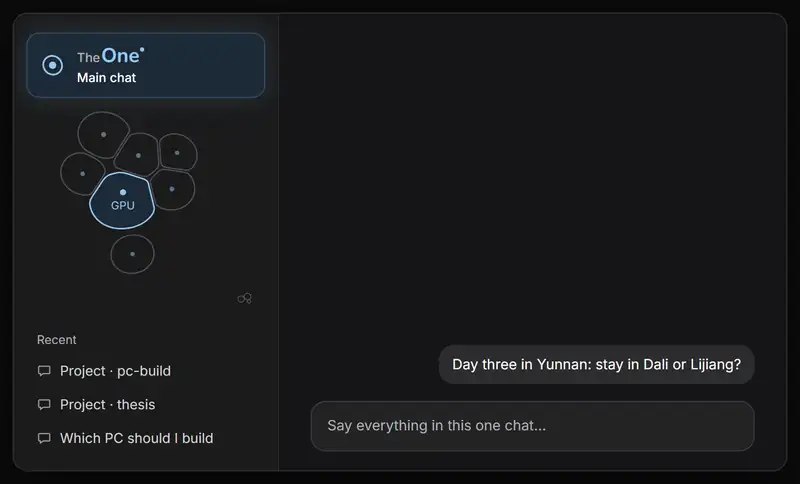
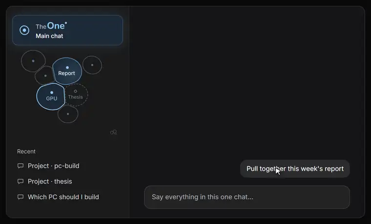
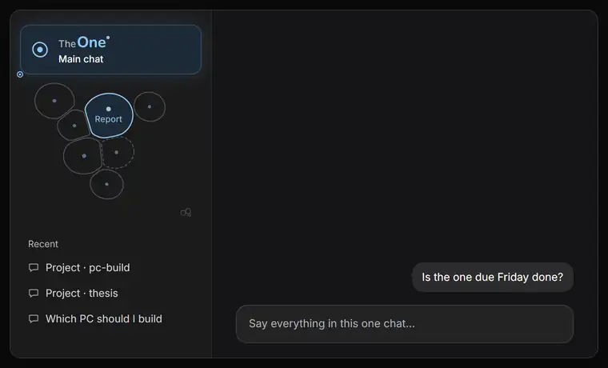
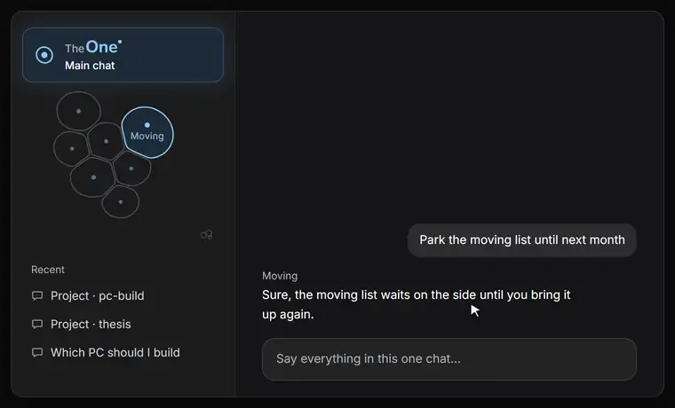
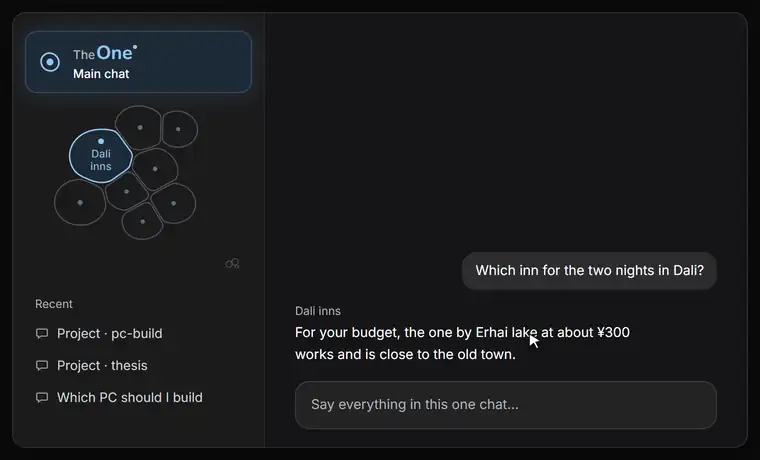
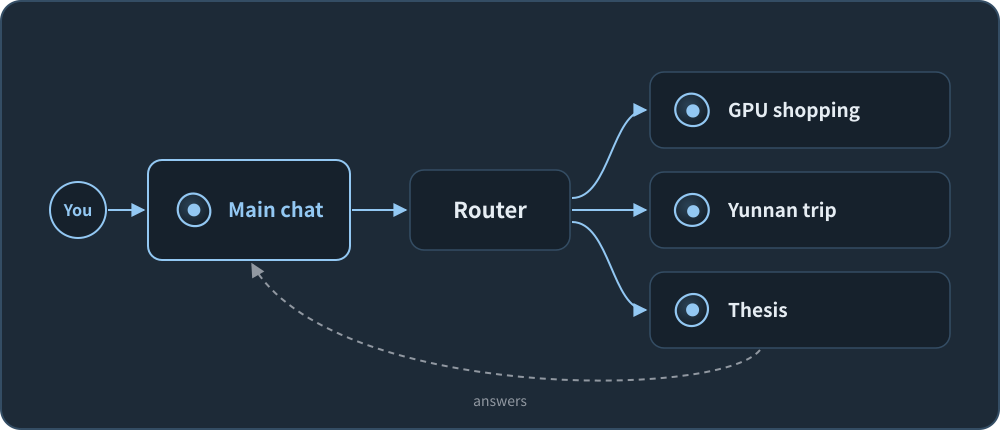
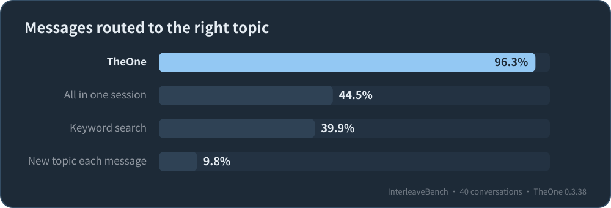

<h1 align="center">
  <picture>
    
  </picture>
</h1>

<b>TheOne is a conversation-routing plugin for DeepSeek Harness (DSH).</b> You talk in one chat; it routes every message to its own topic's separate session. Topics keep their context apart, remember where they stood days later, and can work at the same time in the background.

  
  
  
  

<a href="http://theone.yulid.org/">Website</a> · English | <a href="./README.md">简体中文</a>

  <picture>
    <source type="image/avif" srcset="https://raw.githubusercontent.com/YunongDai2005/dsh-theone/main/docs/images/theone-cluster-demo-en-dark.avif">
    
  </picture>

The Yunnan trip, then the GPU, then something new, and for the unsure last message the other candidate lights up; nothing was clicked. The cluster on the left is TheOne's real drawing code; the window is a mock-up and the conversation an example.

<b>Install:</b> in DSH open <b>Plugins → Add plugin</b>, enter <code>dsh-theone</code> and install. No extra API key.

<b>Questions or problems?</b> Email <a href="mailto:theone@yulid.org">theone@yulid.org</a> or <a href="https://github.com/YunongDai2005/dsh-theone/issues">open an issue</a>. Chinese-speaking users: QQ group 1080980184.

---

## When it helps

- **One chat gets tangled.** You switched topics a few times, the AI mixes earlier things in, and compaction drops the details.
- **The AI forgot.** A new chat means explaining the background all over again.
- **Too many chats to find anything.** Dozens of chats in the sidebar, and last week's one is somewhere in there.
- **Several things at once.** You don't want to wait for one to finish before asking about the next.
- **Away from the computer.** Message from WeChat or Telegram and it still goes to the right topic (experimental).

If you work on one thing at a time and keep few chats, you don't need it.

## Highlights

- **Conversation routing.** Each message is routed automatically: continue the current topic, return to an earlier one, or start a new one. 96.3% routed correctly on the public InterleaveBench benchmark.
- **Separate context per topic.** Each topic is its own DSH session with its own context, project folder and progress notes, so it picks up where it left off days later.
- **Several topics at once.** Bring up something else while a reply is running and that topic starts in the background; up to three topics work at the same time.
- **See where each message goes.** Topics are a cluster of cells under main chat; when routing was unsure, the other candidates stay lit and opening one moves the message.
- **Checks before acting.** If a message may belong to another topic or project, it asks before its first file change or command; "wrong topic" moves it, and the move can be undone.
- **Feels native.** Thinking, tool cards, approvals, questions, todo lists and mid-reply steering work as usual, and work carries on after a DSH restart.
- **Nothing extra to set up.** No separate API key: it uses the model you chose in DSH, and your data stays on your computer.

## Using the topic cluster

<table>
<tr>
<td width="50%" valign="top"><picture><source type="image/avif" srcset="https://raw.githubusercontent.com/YunongDai2005/dsh-theone/main/docs/images/theone-details-en-dark.avif"></picture> <b>Click for details</b>: what it is doing, and carry on in main chat</td>
<td width="50%" valign="top"><picture><source type="image/avif" srcset="https://raw.githubusercontent.com/YunongDai2005/dsh-theone/main/docs/images/theone-candidates-en-dark.avif"></picture> <b>Move it when TheOne was unsure</b>: open a lit candidate and move the message</td>
</tr>
<tr>
<td width="50%" valign="top"><picture><source type="image/avif" srcset="https://raw.githubusercontent.com/YunongDai2005/dsh-theone/main/docs/images/theone-move-en-dark.avif"></picture> <b>Drag in, throw out</b>: drop on main chat to continue, throw out to set aside</td>
<td width="50%" valign="top"><picture><source type="image/avif" srcset="https://raw.githubusercontent.com/YunongDai2005/dsh-theone/main/docs/images/theone-merge-en-dark.avif"></picture> <b>Merge</b>: rest one cell on another to merge, with undo</td>
</tr>
</table>

## Install

1. Set up a model in DSH and check that an ordinary chat works.
2. Open **Plugins → Add plugin**, enter `dsh-theone`, and install.
3. Click **TheOne · Main chat** in the sidebar and start talking.

Works with the DSH 0.2 line (from `0.2.0-rc.2`) and Node.js 24; the interface follows DSH's language (English / Simplified Chinese). When a new version is out, a download icon appears beside the TheOne entry; click it to update.

<b>New to DSH? A step-by-step walkthrough</b>

1. **Get DSH chatting first.** Add your model provider's API key in DSH's settings (DeepSeek's, for example), start an ordinary chat and say hello. Once it replies, you're set: TheOne uses that model.
2. **Install TheOne.** Click **Plugins → Add plugin**, enter `dsh-theone` under package name or address, and install.
3. **Start.** Open **TheOne · Main chat** and tell it what you have going on: today's work, the weekend trip, the paper you're writing. No new chats, no names to come up with.
4. **Changed your mind?** Uninstall it on the Plugins page. Your DSH chats stay; TheOne never deletes them.

<b>Command line</b>

- npm: `dsh plugin --profile web add dsh-theone --ignore-scripts` (use `desktop` instead of `web` for the desktop app)
- GitHub (always the latest main): `dsh plugin --profile web add github:YunongDai2005/dsh-theone --ignore-scripts`

## How it works

You talk in one main chat. Each message is routed first: continue the current topic, return to an earlier one, or start a new one. Every topic is a separate DSH background session that reasons, calls tools and compacts its own context; its answer streams back into main chat, so what you see is always one ordinary conversation.

<picture>
  
</picture>

<picture>
  
</picture>

On the public InterleaveBench benchmark (50 conversations, 2,466 messages, one person pushing 3–5 things forward in the same chat), TheOne 0.3.38 starting with no topics routes **96.3%** of messages correctly, **97.1%** on ten conversations kept aside while tuning; putting everything in one session gets 44.5%. Data, code and scoring are in [`eval/`](https://github.com/YunongDai2005/dsh-theone/tree/main/eval); full results are in the [guide](https://github.com/YunongDai2005/dsh-theone/blob/main/docs/guide.md#how-well-does-it-route).

## FAQ

**How is this different from memory plugins such as MemOS?** 
A memory plugin gives the AI one shared memory store and recalls from it. TheOne routes conversations: different matters go to different sessions, and each session's own context, topic card and progress notes are that matter's memory, so matters never mix.

**Will it cost a lot?** 
Each message adds one short routing call with thinking off; about one in six gets a second look with thinking on, and "ok" or "go on" skip even the first. With DeepSeek V4.1 Flash, routing costs about $0.50 per thousand messages, roughly $2 a month at 100 messages a day. The work itself uses your chosen model, billed as usual.

**Where does my data go? Is there a server?** 
No server. Your data stays on your computer, and requests go straight to the model provider you chose in DSH, never through TheOne's servers; API keys, passwords and the like are removed from what routing sees. See [data and privacy](https://github.com/YunongDai2005/dsh-theone/blob/main/docs/guide.md#data-and-privacy).

**What if a message lands in the wrong topic?** 
Say "wrong topic", or open the lit candidate topic and move the message there. The wrong topic forgets that turn and TheOne learns from the correction; anything the turn already changed is listed for you, never undone behind your back.

**Will it change my existing chats?** 
No. Organising old chats needs your consent first, and it only reads. Uninstall TheOne and your chats are all still there.

**Can I use it from my phone?** 
Yes, experimentally: bind WeChat, Telegram or iMessage in TheOne's settings, and messages from your phone are routed and worked on just like typing in main chat, with replies sent back. Your computer and DSH need to be running. See [from your phone](https://github.com/YunongDai2005/dsh-theone/blob/main/docs/guide.md#from-your-phone-experimental).

**It says the version is too new?** 
DSH installs npm versions only once they are 24 hours old; that is its safety rule, not an error. Wait a day, or install from `https://github.com/YunongDai2005/dsh-theone` right away. If TheOne doesn't appear after installing, restart DSH.

**How do I report a problem?** 
Use Feedback at the bottom of Topic workspaces: it includes the version and diagnostics (no chat content), and you see everything before it is sent. Or email [theone@yulid.org](mailto:theone@yulid.org).

## Recent changes

Version 0.4.6 turns every topic into a cell under main chat so you can see where each message goes, keeps main chat to the conversation, and routes more accurately for less.

Version 0.4.5 adds a short setup after installing or updating, lets topic sessions sit in the sidebar, and turns TheOne's mark into a breathing cell.

Version 0.4.4 fixes right-click Settings in the desktop app and main chat sometimes sticking while it opens, and draws drop-downs in DSH's style.

Earlier versions are in [Releases](https://github.com/YunongDai2005/dsh-theone/releases).

## More

- [Guide](https://github.com/YunongDai2005/dsh-theone/blob/main/docs/guide.md): how routing and topic linking work, settings, data and privacy, known limitations, phone use, full benchmark results, roadmap, development
- [Persistent work](https://github.com/YunongDai2005/dsh-theone/blob/main/docs/persistent-work.md): follow GitHub PRs and CI from main chat (experimental)
- [`llms.txt`](https://github.com/YunongDai2005/dsh-theone/blob/main/llms.txt): one page of facts written for AI assistants

> An unofficial community project, maintained independently; not affiliated with or endorsed by DeepSeek.

🥚

 

Congratulations, you found the easter egg.

In the benchmark, TheOne once made a very human mistake. The user said "the café's autumn menu was due on September 25, let's push it to October 8", and TheOne filed it under the October holiday trip to Yunnan. Both were in October, after all.

We're still training it. If it ever files something of yours in the wrong place, just say "wrong topic" in the main chat. It will remember, and it won't take it personally.

---

If TheOne helps, a ⭐ helps others find it. Questions or ideas? <a href="https://github.com/YunongDai2005/dsh-theone/issues">Open an issue</a> or email <a href="mailto:theone@yulid.org">theone@yulid.org</a>.

