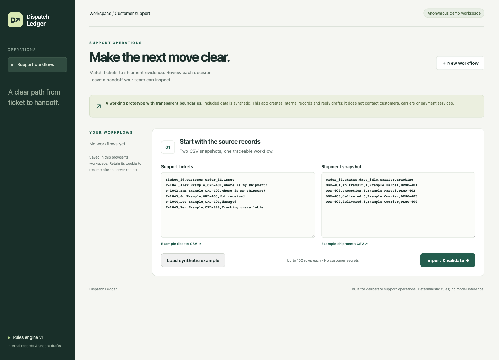
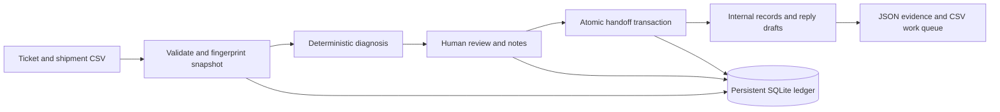

# Dispatch Ledger

A support operations prototype that turns ticket and shipment CSV snapshots into reviewed internal work records and unsent customer reply drafts.

**Current status: locally verified, not deployed on Vultr, not submitted to the hackathon.** Built from new source after the November 3, 2026 15:00 UTC Agent Rush kickoff. This independent branch has no inherited TheOne application code. It uses deterministic rules, not a language model.



## Try the complete workflow

Requires Python 3.11 or newer. The application has no third-party runtime dependencies.

```sh
python3 server.py
```

Open `http://127.0.0.1:3068`.

1. Select **Load synthetic example**, then **Import & validate**.
2. Select **Investigate tickets**. Five cases exercise tracking updates, delayed shipments, delivery disputes, damaged goods and missing orders.
3. Inspect each case's source shipment, proposed action and reply draft. Approve or hold it and enter a review note.
4. Select **Create reviewed handoff**. Approved cases become actual SQLite records; held cases stay in the evidence without creating a work record.
5. Download the evidence JSON and work queue CSV. Reload or restart the server to resume the same workspace.

The fixtures describe fictional customers and carriers. Custom inputs are user-supplied snapshots, not data verified with a carrier. This app does not send replies, contact carriers, update an external CRM, issue refunds or move money. Creating an internal work record does not mean the support issue is resolved.

## How it works



`ledger.py` owns validation, policy evaluation, versioned review and atomic record creation. `server.py` serves the browser interface and limits each signed anonymous workspace to its own records. `public/` is a plain JavaScript interface with desktop and mobile layouts.

| Case | Rule | Result requiring review |
| --- | --- | --- |
| No matching shipment | `MISSING_ORDER` | Investigate source records |
| Damage explicitly reported | `DAMAGE_REVIEW` | Request supporting evidence |
| Shipment marked delivered | `DELIVERY_DISPUTE` | Verify delivery evidence |
| Exception or at least 3 idle days | `CARRIER_FOLLOWUP` | Prepare a carrier follow-up |
| Otherwise | `TRACKING_UPDATE` | Draft the supplied tracking facts |

These are small, explicit demonstration policies. They do not understand arbitrary prose or infer missing facts. Rule order is deliberate: missing-order checks precede damage review, then delivery disputes and delays.

Each review binds to the current revision. A stale tab gets a conflict instead of overwriting a later decision. Reanalysis clears earlier decisions. All approved records and the completion event commit in one SQLite transaction; a failure rolls the whole transaction back. Completed runs are immutable through the application. Retrying completion returns existing records. A source SHA-256 identifies the normalized input snapshot; it does not authenticate the data or make the local database tamper-proof.

## Verified evidence

- 13 local backend/HTTP tests passed, including an exception injected after an actual SQL insert, concurrent duplicate completion, stale review, cross-workspace access, cross-origin requests, formula-safe CSV export and HTTP server restart.
- An actual isolated Chromium session imported 5 synthetic tickets and 4 shipments, reviewed all 5, created 4 internal records and held the missing-order case.
- The browser scenario verified replay without duplicate records, a real server process stop/start, a second workspace denied access, and a 390 px mobile layout without horizontal overflow.
- The raw [browser export](evidence/actual-browser-export.json), [receipt](evidence/browser-receipt.json), [test log](evidence/tests.log) and screenshots are saved. Review notes were entered by test automation, not an independent human reviewer.
- The [local browser recording](evidence/local-browser-workflow.webm) is actual automated browser footage using synthetic inputs. It is a short engineering record, not a narrated hosted deployment demo.

No model or cloud provider was called. These checks demonstrate the scoped local behavior, not production reliability, user research, AI quality, contest eligibility or a security audit.

Run the backend checks:

```sh
python3 -m unittest discover -s tests -v
```

`tests/browser.cjs` requires a separately installed Playwright/Chromium test environment. It launches its own app process, uses a new browser context, records the local workflow, restarts the app and closes both processes. Set `PLAYWRIGHT_MODULE`/`CHROMIUM_PATH` if using an existing installation. It never connects to a personal browser profile.

## Vultr architecture and remaining deployment work

This project targets **Challenge 2: Powering the Future of Work**. The [official brief](https://lablab.ai/ai-hackathons/vultr-hackathon) permits multi-step rule-based workflows and makes Serverless Inference optional for this track. Both tracks require a real Vultr VM backend and deployed web app.

The intended deployment is HTTPS reverse proxy → this Python app → persistent SQLite volume on one Vultr VM. The VM would run diagnosis, review and record creation, rather than serving a static mockup. The prepared `Dockerfile` is a deployment option; it has not been built or deployed in this evidence set. No arbitrary code execution or C1 sandbox-isolation claim is made.

**No Vultr resources, code redemption, balance, applicable no-overage guarantee or public app URL have been verified.** Deployment must wait for the event account's actual free-credit conditions. The advertised $200 does not establish a spending cap. Do not add a payment method or provision paid resources from these instructions. Public judge-access lifetime must be verified separately; no free post-event hosting is promised.

After those conditions are resolved, the operator must configure:

- `LEDGER_BIND=0.0.0.0`, `PORT=8080` inside a container.
- `LEDGER_DATA=/data` on a persistent volume, preserving its session key and database together.
- `LEDGER_HOSTS` as the actual public hostname, without a scheme or port.
- `LEDGER_SECURE_COOKIE=1` behind an HTTPS proxy that preserves the original Host header.
- The app port bound only to the proxy, not exposed directly to the Internet.

A real public browser workflow, deployment identity, access duration and new recorded demo must be collected before claiming a qualifying Vultr build or completing a LabLab submission.

## Operating boundaries

This is an anonymous demonstration workspace, not an enterprise identity system. Its signed HttpOnly SameSite cookie grants access; loss of the cookie loses browser access, while theft could expose that workspace. There are no staff roles, shared-team approvals, SSO, retention UI, external integrations or disaster recovery service. Use fictional inputs for a public demo. Browser requests have origin and host checks, size limits and a restrictive content policy; those are scoped protections, not a claim of comprehensive security.

Each CSV is limited to 100 rows/150 KB, each workspace to 25 workflows, and the database to 2,000 workflows. These bounds are not a cloud billing cap or a replacement for public deployment abuse controls. An operator can inspect/export data locally and manage retention; this build provides no deletion endpoint.

## Provenance and license

New application code, fixtures, UI, tests and documentation were produced with Codex assistance during the event window. Automated review notes and synthetic examples are explicitly labeled. No prior contest entry, frozen branch, customer data, external testimonial or model output is represented as this project's new work.

MIT license. No award, ranking, final submission or real customer deployment is claimed.
