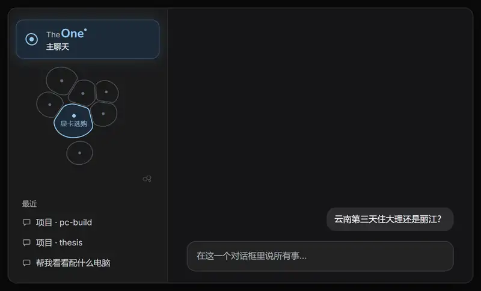
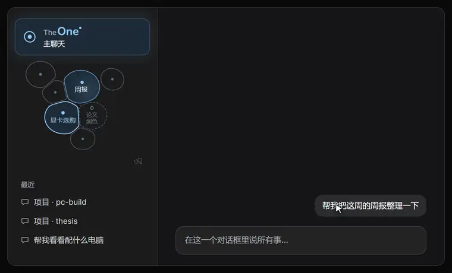
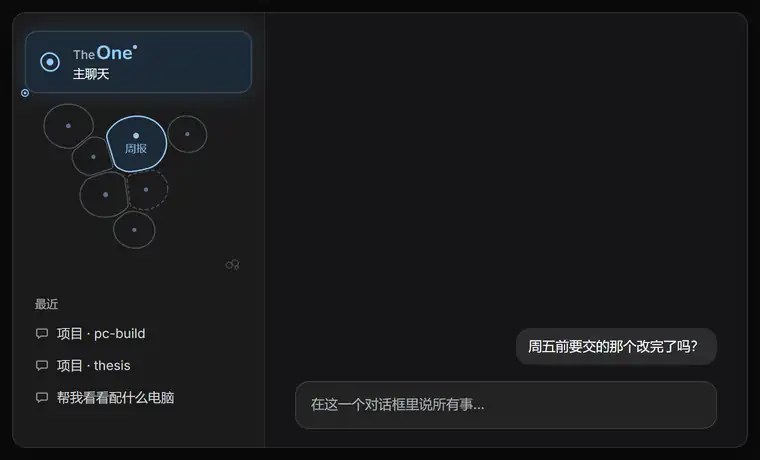
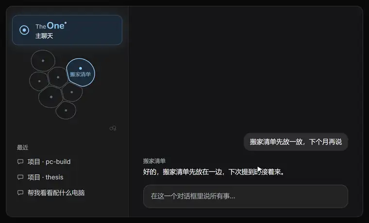
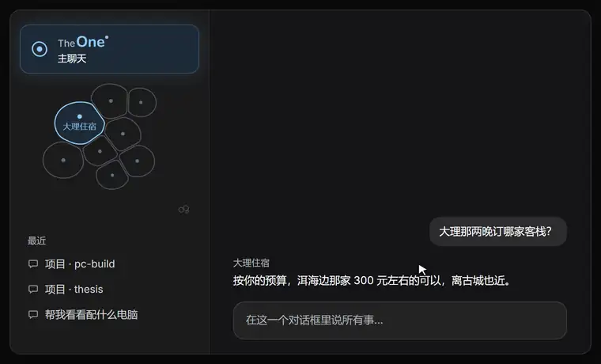
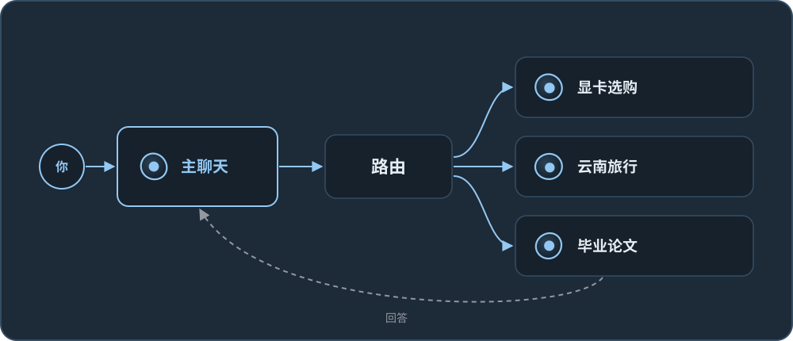
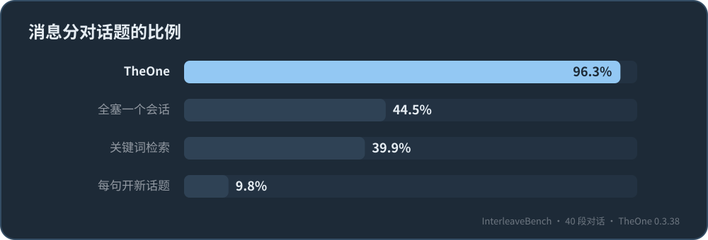

<h1 align="center">
  <picture>
    
  </picture>
</h1>

<b>TheOne 是 DeepSeek Harness（DSH）的对话路由插件。</b> 你只在一个对话框里说话，它把每条消息自动路由到对应话题的独立会话：每件事上下文不串，隔几天回来也记得进度，几件事可以同时在后台做。

  
  
  
  

<a href="http://theone.yulid.org/">项目主页</a> · 简体中文 | <a href="./README.en.md">English</a>

  <picture>
    <source type="image/avif" srcset="https://raw.githubusercontent.com/YunongDai2005/dsh-theone/main/docs/images/theone-cluster-demo-zh-dark.avif">
    
  </picture>

先问云南，再问显卡，然后开了一件新事，最后一句拿不准时另一个候选话题亮了一下，中间什么都没点。左边的细胞团是 TheOne 真实的绘制代码，窗口是模拟的，对话是示例。

<b>安装：</b>DSH 里打开 <b>插件 → 添加插件</b>，填 <code>dsh-theone</code>，点安装。不用另填 API Key。

<b>QQ 交流群：1080980184</b> 装不上、分错了、想要什么功能，进群说一声，作者在群里。

---

## 什么时候用得上

- **一个会话越聊越乱**：中间换过几次话题，AI 开始把前面的事混进来，压缩一次细节就没了。
- **AI 忘了之前的事**：新开一个会话，又得从头交代背景。
- **会话太多找不到**：侧边栏几十个会话，想回到上周那件事得一个个翻。
- **几件事想同时推进**：不想等一件做完再问下一件。
- **不在电脑前也想接着说**：在微信、Telegram 里发消息，照样分到对应的事（实验功能）。

一次只做一件事、会话本来就不多的话，用不上它。

## 亮点

- **对话路由**：每条消息自动判断是接着当前话题、回到旧话题，还是开新话题。在公开评测 InterleaveBench 上分对 96.3%。
- **每件事独立上下文**：每个话题是一个独立的 DSH 会话，有自己的上下文、项目文件夹和进度记录，隔几天回来也接得上。
- **几件事同时做**：回答进行中说起别的事，那个话题马上在后台开工，最多三个话题同时干活。
- **看得见每句话去了哪**：话题是主聊天下面的一团细胞；路由拿不准时，候选话题会亮着，点开就能把消息换过去。
- **动手前先确认**：可能分错话题或项目时，第一次改文件、跑命令前先问你；分错了说一句「分错了」就能挪走，也能撤销。
- **和原生会话一样**：思考、工具卡片、授权、提问、待办、中途插话都照常，DSH 重启后也能接着做。
- **零额外配置**：不用另填 API Key，用的就是你在 DSH 里选好的模型，数据都在你自己的电脑上。

## 细胞团怎么用

<table>
<tr>
<td width="50%" valign="top"><picture><source type="image/avif" srcset="https://raw.githubusercontent.com/YunongDai2005/dsh-theone/main/docs/images/theone-details-zh-dark.avif"></picture> <b>点一下看详情</b>：它在做什么、要不要在主聊天接着聊</td>
<td width="50%" valign="top"><picture><source type="image/avif" srcset="https://raw.githubusercontent.com/YunongDai2005/dsh-theone/main/docs/images/theone-candidates-zh-dark.avif"></picture> <b>拿不准时换过去</b>：候选话题亮着，点开就能把消息换过去</td>
</tr>
<tr>
<td width="50%" valign="top"><picture><source type="image/avif" srcset="https://raw.githubusercontent.com/YunongDai2005/dsh-theone/main/docs/images/theone-move-zh-dark.avif"></picture> <b>拖到主聊天、甩走</b>：拖上去接着聊，甩出去先放一边</td>
<td width="50%" valign="top"><picture><source type="image/avif" srcset="https://raw.githubusercontent.com/YunongDai2005/dsh-theone/main/docs/images/theone-merge-zh-dark.avif"></picture> <b>合并</b>：停在另一颗上就合并，可以撤销</td>
</tr>
</table>

## 安装

1. 在 DSH 里配置好模型，确认普通会话能正常聊天。
2. 打开 **插件 → 添加插件**，填 `dsh-theone`，点安装。
3. 点左侧 **TheOne · 主聊天**，开始说话。

兼容 DSH 0.2 系列（`0.2.0-rc.2` 起）与 Node.js 24，界面跟随 DSH 的语言（简体中文 / English）。有新版本时，TheOne 入口右边会出现下载图标，点一下就更新。

<b>第一次用 DSH？手把手来一遍</b>

1. **先让 DSH 自己能聊天**：在 DSH 设置里填好模型服务的 API Key（比如 DeepSeek 的），新建一个普通会话发一句「你好」，能收到回复就行。TheOne 用的就是这个模型。
2. **装 TheOne**：点左侧 **插件 → 添加插件**，在「包名或地址」里填 `dsh-theone`，点安装。
3. **开始用**：点 **TheOne · 主聊天**，把手头的事一件件说出来：今天的工作、周末的旅行、要写的论文……不用新建会话，也不用起名字。
4. **不想用了**：在插件页卸载。你原来的 DSH 会话都还在，TheOne 从来不删它们。

<b>命令行安装</b>

- npm：`dsh plugin --profile web add dsh-theone --ignore-scripts`（桌面端把 `web` 换成 `desktop`）
- GitHub（总是最新的 main）：`dsh plugin --profile web add github:YunongDai2005/dsh-theone --ignore-scripts`

## 它怎么做

你只在一个主聊天里说话。每条消息先经过路由：接着当前话题、回到某个旧话题，还是开一个新的。每个话题是一个独立的 DSH 后台会话，在里面推理、调用工具、压缩上下文；回答实时回到主聊天，你看到的始终是一个普通的对话。

<picture>
  
</picture>

<picture>
  
</picture>

在公开评测 InterleaveBench（50 段对话、2466 条消息，模拟一个人在同一个对话框里同时推进 3–5 件事）上，TheOne 0.3.38 从零开始边聊边建话题，分对 **96.3%** 的消息；调参时没动过的 10 段对话是 **97.1%**；全塞进一个会话只有 44.5%。数据、代码和打分脚本都在 [`eval/`](https://github.com/YunongDai2005/dsh-theone/tree/main/eval)，完整结果见[工作原理与评测](https://github.com/YunongDai2005/dsh-theone/blob/main/docs/guide.zh.md#它分得有多准)。

## 常见问题

**和记忆类插件（比如 MemOS）有什么不同？** 
记忆类插件给 AI 加一个总的记忆库，做事前召回相关内容。TheOne 做的是对话路由：把不同的事分进不同的会话，每个会话自己的上下文、话题卡片和进度记录就是那件事的记忆，不同的事不会搅在一起。

**会不会很费钱？** 
每条消息多一次很短的路由调用（不开深度思考），大约六条里有一条会开着思考再判断一次，「好的」「继续」这类连第一次都省了。用 DeepSeek V4.1 Flash，路由大约每一千条消息 0.5 美元，每天发 100 条，一个月多花约 2 美元。干活本身用你选的模型，和平时一样计费。

**数据去哪了？要另外的服务器吗？** 
不要。数据都在你自己的电脑上，请求直接发给你在 DSH 里选的模型服务商，不经过 TheOne 的服务器；发给路由的内容会去掉 API Key、密码等敏感信息。详见[数据与隐私](https://github.com/YunongDai2005/dsh-theone/blob/main/docs/guide.zh.md#数据与隐私)。

**分错了怎么办？** 
说一句「分错了」，或者点开亮着的候选话题把消息换过去。分错的话题会忘掉那一轮，TheOne 也会记住这次纠正；那一轮已经做过的改动会列给你，不会在背后悄悄撤销。

**我原来的会话会被改吗？** 
不会。整理旧会话要你先同意，只读不改。卸载 TheOne 后，原来的会话都还在。

**能在手机上用吗？** 
可以（实验功能）：在 TheOne 设置里绑定微信、Telegram 或 iMessage，手机上发的消息和在主聊天里打字一样分到话题、在后台干活，回复发回手机。电脑和 DSH 要开着。详见[在手机上用](https://github.com/YunongDai2005/dsh-theone/blob/main/docs/guide.zh.md#在手机上用实验功能)。

**提示版本「太新」、装不上？** 
DSH 默认只安装发布满 24 小时的版本，这是它的安全规则，不是出错。等一天再装，或者改填 GitHub 地址 `https://github.com/YunongDai2005/dsh-theone` 马上就能装。装完左侧没看到 TheOne，重启一下 DSH。

**遇到问题怎么反馈？** 
在话题工作区页面底部点「反馈」，会带上版本和诊断信息（不含聊天内容），发送前能看到全部内容。也可以进 QQ 群 1080980184，或者发邮件到 [theone@yulid.org](mailto:theone@yulid.org)。

## 最近更新

0.4.6 把话题变成主聊天下面的一团细胞，每句话去了哪都看得见，主聊天里只剩对话，路由也更准更省。

0.4.5 加了安装和更新后的设置向导，话题会话可以显示在侧边栏，标识换成了会呼吸的细胞。

0.4.4 修好了桌面版右键「设置」和主聊天偶尔卡在打开中，下拉框改成 DSH 风格。

更早的版本见 [Releases](https://github.com/YunongDai2005/dsh-theone/releases)。

## 更多文档

- [使用说明与工作原理](https://github.com/YunongDai2005/dsh-theone/blob/main/docs/guide.zh.md)：路由和话题联动怎么做、设置项、数据与隐私、已知限制、在手机上用、完整评测、路线图、开发
- [持续任务](https://github.com/YunongDai2005/dsh-theone/blob/main/docs/persistent-work.md)：在主聊天里跟进 GitHub PR 和 CI（实验功能）
- [`llms.txt`](https://github.com/YunongDai2005/dsh-theone/blob/main/llms.txt)：写给 AI 读的一页事实

> 非官方社区项目，由社区成员独立维护，与 DeepSeek 不存在隶属或背书关系。

🥚

 

恭喜，你找到了彩蛋。

在评测里，TheOne 犯过一个很有人味的错：用户说「咖啡店秋季新品本来定 9 月 25 上，现在想推到 10 月 8 号」，它把这句话放进了「国庆云南六日游」，因为都在十月。

我们还在调教它。如果你也被它分错了，在主聊天里说一句「分错了」就行，它会记住，不会生气。

---

觉得有用的话，点个 ⭐ 让更多人看到。遇到问题或有想法，欢迎进 QQ 群 1080980184，或者 <a href="https://github.com/YunongDai2005/dsh-theone/issues">提 Issue</a>，打不开 GitHub 就发邮件到 <a href="mailto:theone@yulid.org">theone@yulid.org</a>。

