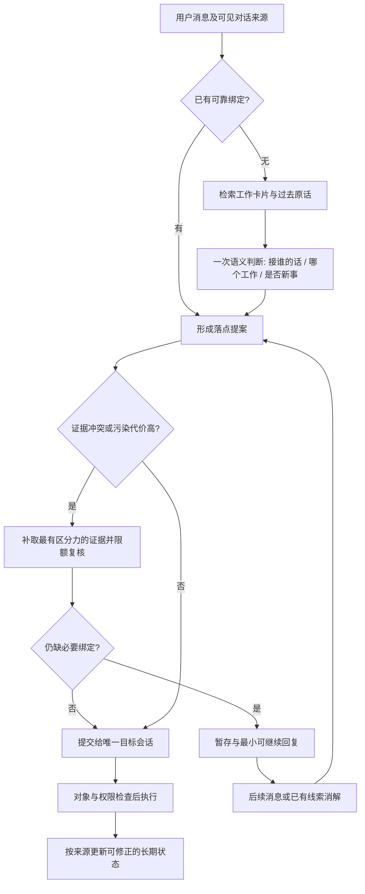

# 重新想一遍 TheOne 的消息路由

> 研究日期：2026-11-01；代码快照：`efa742e8f650a7d052d4c412b9eeae85b87f42cf`。仅设计研究和离线实验，无模型 API 调用，无产品代码修改，无 Git 提交。

## 先说结论

**建议保留便宜模型做语义判断，把下一阶段的重点放在“知道用户接的是哪段对话”和“避免一次误判改变后续记忆”。** 当前证据最支持的架构是：可追溯的对话状态，配合有界的历史检索，一次语义判断，再按污染与执行风险决定是否复核、何时写入持久会话。保留一个实际执行者。

这是一项有证据支撑的设计推荐，还没有证明它是全局最优。已有离线数据能排除几条不合适的捷径，却不能验证真实助手回复、并行插话和工具副作用下的最终效果。

- **本地词面方法适合找候选，不适合接管全部路由。** 用仓库现有 BM25 基线从空目录自行建话题，准确率为开发集 **39.85%**、测试集 **41.67%**（本轮实测，E2）。给它现成目录则为 **73.33% / 76.67%**；二者差异同时包含冷启动、建话题和错误历史，不能只归因于其中一个。
- **历史归属本身是需要保护的状态。** 同目录、同算法，仅改变历史更新方式，开发集从正确历史下的 **80.20%** 降至自己预测历史下的 **67.01%**，测试集从 **80.48%** 降至 **72.62%**（本轮实测，E3）。这个受控诊断支持延迟学习、按来源撤销及重新计算，不能据此声称现有 LLM 会有同样降幅。
- **扩充快路前要先补评测。** 当前裸短句快路在数据上命中 **0/1,971、0/495**；可计分的 implicit 消息却全部接续上一件非单次工作，分别是 **499/499、115/115**（本轮实测，E1、E4）。这份数据没有覆盖“用户回复前台 A，后台 B 刚好完成”的关键反例。
- **现在最有价值的工程顺序是：对齐真实路由链路的评测 → 保存可见对话的来源和焦点 → 控制错误写入与副作用 → 验证局部快路和复核策略。** 缓存重排已经做过，不应把它再当成尚未实现的最大改动；本轮的进一步重排只改善了离线估算，不能代替账单和延迟实测。

全文的数字按以下口径使用：**本轮实测**是本地脚本在指定切分上计算的结果；**历史记录**是旧报告记载的实测，本轮没有原始预测可复算；**估算**包括字符换算 token、成本情景和统计假设；**建议门槛**是尚未验收的设计目标。代码中的数量限制另标为静态事实。日期、版本、文件行号不是性能测量。

实验入口：[analyze.py](../../experiments/routing-rethink/analyze.py)、[source-probes.mjs](../../experiments/routing-rethink/source-probes.mjs)，完整结果和复现说明见 [实验目录](../../experiments/routing-rethink/README.md)。

## 读代码前的独立路线（先行记录）

这部分先于本轮读取 `src/llm-router.ts`、`docs/design/` 下既有方案落盘，后续保留原文。已知信息仅来自任务说明及既有记忆中的产品边界：TheOne 路由持久会话，目标会话执行工作。本轮记忆检索也返回过既往实现概述，因此不声称完全盲测；下列路线不把既往实现或效果当作已验证事实。

问题的基本单位是“用户现在要继续的工作”，不是领域标签。同一领域可以有两件不同工作，同一件工作可以跨领域。消息的语义、它回答谁、当前有哪些未完成承诺，是不同证据。正确的会话落点也不等于安全的执行决定。

| 路线 | 核心机制 | 为什么可能更好 | 最大风险 | 如何验证与否证 |
| --- | --- | --- | --- | --- |
| A. 直接语义判别 | 以当前消息和每个工作的短描述为输入，一次判断已有工作或新工作；允许都不匹配。 | 结构简单、覆盖开放表达；给其他路线提供公平基线。 | 同领域工作描述很像；省略句缺乏信息；新增话题门槛难校准。 | 分开测新工作、回旧工作、同域切换、无词面线索；若补状态仍不改善，则语义描述不足不是主瓶颈。 |
| B. 对话状态与注意力 | 维护正在对用户说话的工作、未回答问题、待批准动作和用户刚看见的结果；短回复先解释成一次状态转移。 | “可以”“下一步呢”往往是在回应一个对话动作，没必要重做全局分类。 | 后台完成顺序不等于用户注意力；多个问题同时待答时会误绑定。 | 按时间重放前台可见事件；消融可见焦点与待答状态；专测后台插播和跨日恢复。若焦点错误抵消收益，不能当硬规则。 |
| C. 消息回复图 | 先找当前消息回应哪条历史消息，再继承该消息的工作；显式回复、引用、纠正都是边。 | 先解决“接谁的话”，可保留一件事被打断后恢复的线索；不必把全部历史压成一个摘要。 | 隐式回复边仍需推断；错误边沿图传播；历史越长候选越多。 | 比较最近消息、最近用户消息、回复边与摘要检索；按打断距离分桶；测错误传播长度，不只测单次准确率。 |
| D. 实例检索与在线归组 | 检索以前的原话、产物名、路径和已确认纠正；消息按可检索实例归组，新信息逐步形成工作簇。 | 某个细节被摘要丢掉后仍能找回；用户纠正可变成下次可用的局部例子。 | 词面相似冒充任务相同；错误归组自我强化；全量历史检索有隐私和成本负担。 | 严格只检索当前时刻之前的信息；比较摘要和原话的候选召回率；以整段对话切分，检查无未来标签泄漏。 |
| E. 工作对象与动作约束 | 把仓库、文件、订单、地点等对象和动作的前提作为约束；先排除不可能的会话，再解释自然语言。 | 两件同域工作仍常有不同对象；错误写入风险可以在执行前被发现。 | 一句话可能跨对象；路径别名、对象迁移和未声明对象会让硬排除伤召回。 | 做同域不同对象、别名与对象变更对照；记录约束误排率；仅确定的权限或明确绑定可硬限制，弱语义只能加分。 |
| F. 风险决策与暂存 | 先产生可修正的落点提案；高污染风险的消息暂存于主聊天或待定记录，验证证据后才写入长期记忆与执行。 | 直接优化用户损失；避免把“猜中概率更高”误当成“现在就值得写入”。 | 暂存会拖延工作；事后删消息不能撤销已执行工具；新话题可能泛滥。 | 扫描风险与覆盖率的取舍，分别计污染、拆分、延迟、追问；注入误路由后测恢复和重复执行。若暂存只把错误藏起来而没有可继续路径，应否决。 |

这些路线可组合，但不能先假定每层都该加上。先验证哪个信息真正缺失，再挑最小组合。A 与 D 主要补“找得到”，B 与 C 主要补“接得上”，E 主要补“对象不串”，F 主要限制“错了的损失”。

初始可证伪预测：纯“跟随上一个话题”会受切换率限制；纯词面检索对实体明确的旧任务有效，对省略句无力；把全部候选交给更强推理不一定补得上缺失的对话状态；只看总体准确率可能掩盖少量严重污染。

## 现实中的链路，以及评测实际覆盖到哪里

以下是本轮源码检查的静态事实，针对上述快照，不代表已经验证真实 DSH 的运行效果。

| 环节 | 当前实现 | 对研究的影响 |
| --- | --- | --- |
| 快路与当前话题 | `src/index.ts:847` 起处理目标绑定、轮内 steering、纯附件和 `continuesCurrent`；后台来信另有分类入口。 | 不能把所有“回复中到来的消息”统称为盲目 KEEP；可信事件绑定与自然语言推断应分开测。 |
| 候选集合 | `src/history-catalog.ts:298` 起；小目录直接全给，大目录保留至多 16 个，结合词面、先验和 DSH 搜索；当前话题有强保留偏置。 | 候选是否包含正确工作，与候选内是否选对，是两个不同指标。 |
| 模型看到的状态 | `RecentMessage` 只有 role/text；`src/index.ts:1629` 收集近期消息，payload 常态保留 12 条。另有 currentId、running、项目和 done/waiting。 | 已有上下文能力，但近期话语没有 messageId/topicId/回复关系；“最后挂载的话题”无法直接证明“用户正在回应谁”。 |
| 复核 | `src/routing-evidence.ts` 的 `secondLook` 在 CREATE、CLARIFY、唯一线索冲突时触发；`src/index.ts:2500` 先把线索限制在已入选候选内。 | 无独有线索的错误 KEEP/SWAP 不会触发；候选外的线索也不能通过这条分支补救。 |
| 新建前查遗漏 | `src/index.ts:2513` 在 CREATE 时最多并发检查 3 页，每页至多 16 个，当前话题可能占一位。 | 翻页有成本，也不是无限目录的完整检索证明；自信地选错旧话题不会进入此分支。 |
| 不确定收尾 | `settleUnclear` 优先选候选中的当前话题，否则首候选，再退到当前话题；常规不确定不再追问。 | “不打断用户”已经做到一部分，但不确定性被转成了实际落点；E5 的手工控制输入复现了这种行为。 |
| 参考资料 | `src/index.ts:1883` 起把 `relatedIds` 和 `alternateIds` 都纳入参考候选，并保留私密/手工隔离检查。 | “这次确实要用到 B”与“也许其实该去 B”是不同证据。备用话题进入 briefing 后的内容影响，单纯落点评分看不到。 |
| 执行和纠错 | 已有 `checkTargets`、handback 和 `noteMisroute`。后者记录误路由事件范围和已发生的改动。 | 可复用这些基础；记录排除与纠错不是自动回滚外部副作用，也不能保证所有第三方记忆都被清除。 |
| 输入与计量 | 稳定目录在前、动态 states 在后、固定系统提示词、短 reason 和回执指标已在代码中。 | 初版深化方案关于“text 在第一项”的现状描述已经过时；应以阶段实施报告和源码为准。 |

**现有 InterleaveBench 路由回放只覆盖其中一段。** `eval/run-router.mjs` 使用 dist 中的提示词、payload、校验、快路、规则和可选复核/卡片；没有复现 `HistoryCatalog.candidates`、新建前补查、`settleUnclear`、真实工作会话执行、退回及跨话题 briefing。它的输入也没有真实助手回复、工作目录、前台可见事件或真实时间。因此不能把它的分数直接称为“当前完整产品准确率”。本轮在该数据能形成的请求上核对 source/dist payload 与系统提示词，**4,932/4,932 一致**（本轮实测，E4；open/closed 各遍历全量数据）；这只证明请求构造一致，没有填上其余覆盖缺口。

### 历史模型结果能说明什么

以下均为 [docs/routing-eval.md](../routing-eval.md) 记载的旧实测，**本轮未重新调用模型、未复算原始预测**：

| 当时的 dev/open 组别 | 准确率 | 放错到别的话题 | 每千条花费 |
| --- | ---: | ---: | ---: |
| 关思考 | 90.1% | 2.4% | $0.41 |
| 关思考 + 选择性复核 | 96.3% | 2.8% | $0.49 |
| 全程开思考 | 96.5% | 1.5% | $0.55 |
| 选择性复核 + 卡片 | 96.9% | 1.9% | $0.65 |

旧报告把未复核的错误列为 KEEP **24** 例、SWAP **18** 例。这提供了“自信选错旧话题”值得研究的线索；不能当成当前版本的错误分布。现有 `eval/data/interleave-v0` 只有数据和 manifest，没有这些真实模型预测；`eval/.cache` 的已观察顶层只有 fake。未继续搜索用户的其他工作目录或凭据。

旧报告还记载卡片增加的花费中约 **$0.07** 来自卡片生成，约 **$0.09** 来自更长路由输入（历史记录，同一 dev/open 对照）。说明维护摘要的成本不止后台那次调用。它没有单独对比旧卡片与新卡片，所以不能把收益归到某一个字段。

## 本轮离线实验

### E1. 先检查数据是否适合回答问题

来源：`analyze.py` → `results/analysis.json.profile`，本轮实测，`interleave-v0` 原有 dev/test 切分；没有重新生成数据。

| 范围 | 对话段 | 全部消息 | 非歧义、非单次问题的计分消息 | 歧义消息（含单次问题中的歧义） | 单次问题 |
| --- | ---: | ---: | ---: | ---: | ---: |
| dev | 40 | 1,971 | 1,631 | 273 | 88 |
| test | 10 | 495 | 420 | 62 | 20 |

两种语言在各切分的会话数相等；每段包含 **3–5** 件事（本轮实测，同脚本）。记录 ID、turn 顺序、gold 和 refs 外键检查通过，manifest 总数一致。test 中有 **6** 条消息的规范化文本也出现在 dev，对应 **2** 种原话；本轮没有靠原话记忆训练分类器，仍应记录这个重复，不能把测试集描述为完全无重合。

主要限制不是数据损坏，而是任务覆盖：

- dev/test 都没有助手回复字段或时间戳（本轮实测）。工作对象、写文件副作用、用户是否看见回复，也不在数据中。
- implicit 的计分样本 **499/499、115/115** 都延续上一件非单次工作。`eval/lib/schedule.mjs` 的样式分配只在 continue 中提供 implicit；switch/return 没有这个样式（静态事实）。这个规律不能变成真实产品的硬规则，更不能把数据里的 style 标签当运行时输入。
- 歧义消息占全量 **13.85% / 12.53%**；pronoun 中被排除的比例分别为 **22.22% / 18.52%**（本轮实测）。严格分数合理地排除了标签争议，却没有证明产品能处理这些争议。
- gold 来自生成前计划，judge 来自独立模型读法；不是人工审定的自然聊天。合成测试适合回归，真实误路由率仍未知。

### E2. 直接替换成简单本地路由，会怎样

来源：`analyze.py` 调用原有 `eval/baselines.py` 的 route 和 `eval/score.py` 的 evaluate，逐条把自身预测加入历史。所有参数保持仓库默认，预测落在本实验目录；不执行原脚本会写回 eval 的 main。下表均为本轮实测，严格计分分母为 dev **1,631**、test **420**。

| 基线 | dev 准确率 | test 准确率 | dev 污染率 | test 污染率 |
| --- | ---: | ---: | ---: | ---: |
| 已有目录，首次词面选中后一直留在该话题 | 43.41% | 48.33% | 56.59% | 51.67% |
| 已有目录，BM25 + 自己的历史 | 73.33% | 76.67% | 26.67% | 23.33% |
| 空目录，BM25 + 自己建话题和历史 | 39.85% | 41.67% | 40.65% | 39.76% |
| 全部放一个话题 | 44.51% | 48.81% | 55.98% | 51.19% |
| 每条消息新建话题 | 9.81% | 9.05% | 0.00% | 0.00% |

这里“污染率”特指 scorer 的 `wrong_existing + merged_new`，除以严格计分消息数；它衡量送入另一件工作占多数的会话，不是实际 Worker 被错误知识影响的概率。open 准确率采用事后全会话的一一匹配，污染采用到达时的多数内容，所以**准确率与污染率不互为补数**。歧义消息仍可影响映射和之前的会话内容；未来评测应另给只用严格样本对齐的敏感性结果。

“每条新建”虽然零污染，却把每件事拆成平均 **11.623 / 11.585** 个话题（本轮实测，同 scorer 的完整话题消息口径，包括歧义消息）。因此 F 路线必须保证可继续的工作状态，不能通过无限新建刷低污染。

词面方法的具体弱点也不是只在短句：closed BM25 在 dev 的 twin 标签准确率为 **55.45%**，implicit 为 **68.14%**，pronoun 为 **63.21%**（本轮实测，分别是各标签的严格样本；标签可重叠，不能相加）。这些是本地基线错误分布，**不是现有 LLM 的错误分布**。

补充损失敏感性保存在 `analysis.json.baselines.*.loss_sensitivity`：污染代价分别按 **1、3、10**，拆分按 **1** 计算（假设权重，不是用户损失的实测金额）。始终保留各类错误的原始计数，不能只优化某一个任意加权总分。

### E3. 检索原话有帮助，但必须保护历史归属

先做“信息能否找回”的诊断。事先给出 title/description，把到当前时刻之前的消息按 gold 放入历史；当前消息先预测后更新，不读取未来消息，也不读取 facts/update。历史归属是理想条件，目录描述也是由生成计划提供；以下均非上线准确率。

来源：`analyze.py` → `diagnostics`；本轮实测，计分分母同 E2。

| 诊断方法 | dev 首选正确 | test 首选正确 |
| --- | ---: | ---: |
| 只检索固定标题和描述 | 985/1,631（60.39%） | 270/420（64.29%） |
| 固定描述 + 按正确归属积累的过去原话 | 1,245/1,631（76.33%） | 323/420（76.90%） |
| 找最相似的一条过去用户消息，继承它的工作 | 923/1,631（56.59%） | 246/420（58.57%） |
| 假设知道上一件非单次工作的正确归属，始终接它 | 1,100/1,631（67.44%） | 271/420（64.52%） |

完全没有词面重合的样本，从固定描述下的 **339/1,631、80/420** 降为原话累计后的 **63/1,631、16/420**（本轮实测，同诊断）。D 值得保留为补充信息来源；C 若只实现成“找最相似旧句”则没有胜出，真正的回复关系需要来源信息和对话动作。

只看已有工作的后续消息，累计原话的前 **3** 个候选覆盖 **1,356/1,469（92.31%）**、**352/380（92.63%）**。最近 **12** 条非单次工作消息中，出现过正确工作的比例为 **1,433/1,469（97.55%）**、**372/380（97.89%）**（本轮实测；窗口条数是实验参数）。后一个结果只说明正确工作在窗口内出现过，**不表示能识别当前消息接哪一条**；它还依赖理想的单次问题识别，不能等同于产品的 recent 窗口。

再做一个只改历史更新方式的对照，避免把 E2 的目录差异错归因到错误累积：相同 closed 目录、相同 BM25 首选规则；有重合取最高分，无重合留在当前工作；两组都由 oracle 隔离单次问题。每条过去消息分别按 gold 或算法自己的输出加入历史。

来源：`analyze.py` → `matched_history`；本轮实测。

| 更新历史的归属 | dev | test |
| --- | ---: | ---: |
| 过去的真实标签 | 1,308/1,631（80.20%） | 338/420（80.48%） |
| 过去的自身预测 | 1,093/1,631（67.01%） | 305/420（72.62%） |

这才是同政策下历史反馈的对照。说明“真实标签模拟已确认历史”的快路实验可能乐观；尚未证明延迟学习本身能追回上述差距。真正的延迟学习也可能损失新信息，下一阶段必须把这两种效果一起测。

### E4. 本地方法更适合作候选和选择性判断

**选择性判断。** 仍用 E3 的理想历史，扫描 BM25 第一、第二名分差，预设开发集选取条件为经验正确率至少 **99%**、至少接管 **30** 条，选择覆盖最多的阈值；这些是实验选择条件。test 不参与选阈值。

来源：`analyze.py` → `selective`；本轮实测。分母为所有非歧义消息，**包括单次问题**，dev **1,698**、test **433**；把单次问题接入旧工作也算接管错误。

| 开发集选出的分差阈值 | dev 接管覆盖 | dev 接管正确 | test 接管覆盖 | test 接管正确 |
| --- | ---: | ---: | ---: | ---: |
| 8（BM25 分差，不是概率） | 155/1,698（9.13%） | 154/155（99.35%） | 56/433（12.93%） | 56/56（100.00%） |

完整开发集曲线和错误原话已保存。本实验不是旧方案临时脚本的复现，评分、分母和方法不同，不能拿覆盖数字直接比较。过去真实标签、预置目录、少量样本都使它不足以支持上线；也没有任何真实 LLM 预测可用于比较相同子集，不能声称它比现有模型更准。

即使暂按独立伯努利试验，**56** 条零错对应的单侧 **95%** 错误率上界仍约 **5.21%**（估算，`1 - 0.05^(1/56)`；聊天消息实际上相关，此估算不构成上线保证）。要扩快路，需要更多独立对话、自己的预测历史、候选污染及真实模型的配对结果。

**唯一数字或名字。** `source-probes.mjs` 直接调用 `src/routing-evidence.ts`，给定目录并逐条加入过去 gold 历史，不生成卡片。只有一个话题持有线索且消息非歧义时，命中归属正确的比例为 **179/214（83.64%）**、**46/57（80.70%）**；排除单次问题后仍只有 **179/196（91.33%）**、**46/53（86.79%）**（本轮实测，dev/test）。例子 `en-0004/i=29` 中，新开蜡烛店的消息因为年份 `2026` 被另一工作持有而产生错误线索。**唯一出现不等于唯一意图。** 线索适合触发核对，不能直接改写落点。

**大目录受控实验。** 同脚本直接调用 `HistoryCatalog.candidates`，只给伪造的空 FTS 返回和空使用先验，不启动目录扫描或模型。以当前会话的预置目录和 gold 历史为基础，加入同语言 dev 会话的固定标题/描述作为干扰目录；test 干扰项也只来自 dev。没有把其他会话的未来消息放入索引。这是人为扩充的跨用户目录，和实际长期个人目录不同。

下表为本轮实测的候选 Recall@16，分母为已出现工作的非歧义后续消息；干扰项数量是实验条件：

| 外加干扰话题 | dev 所有后续 | test 所有后续 | dev 当前话题之外的后续 | test 当前话题之外的后续 |
| --- | ---: | ---: | ---: | ---: |
| 0 | 1,469/1,469 | 380/380 | 415/415 | 118/118 |
| 16 | 1,466/1,469 | 380/380 | 412/415 | 118/118 |
| 64 | 1,462/1,469 | 379/380 | 408/415 | 117/118 |

当前话题被强保留，加上 gold 历史和相对简单的干扰项，会抬高结果。它支持“先保留当前轻量检索”，**不能证明线上召回已经足够**。遗漏原话在 `candidate-misses.json`，如 `en-0034/i=4` 的 “makes sense, keep going” 被前一条单次问题抢走焦点；这是保留长期工作焦点、区分临时问答的具体动机。

### E5. 状态、执行风险：现有小数据只能做有限排除

`source-probes.mjs` 对 `mid-reply/cases.json` 的手写案例运行两个故意简单的对照：盲目跟随 running 和仅调用 `resolveContext`。

| 策略 | 正确案例 / 总数 |
| --- | ---: |
| 所有消息都给正在运行的话题 | 21/35（60.00%） |
| 只看消息和目录的规则 | 16/35（45.71%） |

本轮实测；该集合没有 dev/test 划分。后者在有关 running 的案例中仅 **3/21** 正确，在其他旧话题上为 **10/11**，新工作为 **3/3**。规则对照没有消费 running 的 request/progress，**不是生产 LLM + running 路由的成绩**。它说明“全部跟着正在跑的任务”与“只认名字”都不成立，支持 B/C 继续研究，不足以证明某个状态模型已经有效。

同脚本另对手工构造的“两个候选但无法选择”和“缺历史且无候选”调用 `settleUnclear`，两种都落到当前 a（本轮实测的确定性行为演示，**不是数据集准确率**）。这正是 F 需要保留不确定状态的入口。

未运行 Worker 退回、错误工具动作、自动修正、暂存提交或多轮恢复实验：仓库可用数据没有所需执行轨迹，也未在本次授权范围实现原型。没有把 fake 模型、手写规则或这些控制例子当成真实语义实验。

### E6. 成本：已经实现的优化与尚未证实的收益

本轮重新运行 `eval/prefix-share.mjs` 的函数，并用 `source-probes.mjs` 做保持字段值的反事实序列化：把持续更新的 keywords 从 contexts 移到 states。真实产品代码未改。

下表为**离线估算**，来自同脚本的 `prefixes`；数据为 `interleave-v0` dev/test、gold open/closed 回放。token 按汉字数除以 **1.5**、其他字符除以 **4**，最长公共前缀按 **64** token 向下取整，视为理想复用预算。它不是实际分词、实际账单、服务端命中或请求耗时。

| 切分 / 模式 | 当前可复用比例 | keywords 后移 | 当前估算未命中 token / 请求 | 后移后 |
| --- | ---: | ---: | ---: | ---: |
| dev / open | 77.16% | 79.13% | 502.92 | 459.73 |
| test / open | 77.46% | 79.15% | 501.33 | 463.64 |
| dev / closed | 75.05% | 79.46% | 564.06 | 465.11 |
| test / closed | 74.87% | 79.34% | 571.64 | 470.78 |

当前值与阶段实施报告一致。dev/open 的输入总长估算为每请求 **2,202.37** token，其中固定系统提示词估算 **1,564.33** token；后移关键词并不会让总输入明显变短。还有模型理解 states 字段位置的影响，本次没测，所以不建议把这个小实验直接落进产品。

**估算器的服务端假设也应降级。** 本轮查阅的 [DeepSeek 官方缓存文档](https://api-docs.deepseek.com/guides/kv_cache/) 要求可匹配的前缀单元已经持久化；发现相同前缀后才形成新单元，缓存还受构建和逐出影响。文档目前没有承诺本地脚本这种“任意旧请求的最长前缀按固定 64 token 就能命中”的模型。保留该脚本有利于同口径比较，应称为**文本可复用预算代理**，不能称精确服务端上限，也不把它转写成已省下的钱。

下一轮真正要记的成本为：

`路由成本 = 所有初判、复核、补查的未命中输入 × 单价 + 命中输入 × 单价 + 输出 × 单价 + 卡片/索引维护 + 被撤销推测执行的消耗`

单价从当次实际模型和回执取，不沿用旧报告的价格。最终 tier 只说明最后采用哪一层，不能代替逐调用的层级归属。延迟应同时记用户消息到可见响应的墙钟时间、排队/候选检索时间、模型实际耗时及开始副作用的时间；已有 `latency_ms` 不能替代完整用户等待。

## 收敛后的架构

### 核心状态：记录用户接的是哪件事

将每次路由视为对一件持续工作的归属判断。最低需要保留的状态（设计提议，尚未实现）：

| 状态 | 提供什么证据 | 如何避免新的误绑定 |
| --- | --- | --- |
| 前台可见消息的 messageId、topicId 和顺序 | “好”“下一步呢”回应的对象 | 后台完成只记录后台事件，不能自动抢走前台焦点。无真实已读信号时只称“前台最后展示”，不推断用户已看见。 |
| 待答问题/承诺及其拥有者 | 用户在回答哪一个问题、批准哪一个动作 | 有多个待答问题时不按最后完成时间硬选；标记竞争。 |
| 最近持续工作与临时问答分别记录 | 算术插问结束后可回到原工作 | 临时分类仍需证据，不能用简单长度或问号决定。 |
| 对象绑定、引用来源、版本 | 同域工作区分，过时值与新值并存 | 只有明确路径、工作区授权等才是硬约束；名称相似只是软证据。 |
| 路由提案与长期学习的来源 | 纠错能找到受影响的摘要、别名、事实 | 未纠正不等于用户确认；派生状态都应能按来源排除并重算。 |

这里可以借用回复图的表达，但无需先建设完整知识图谱。最先保存有来源的消息边和工作拥有者；没有真实边时再推断，且保留推断状态。对话解缠研究中确有用回复关系表达内部会话结构的做法，但群聊语料与个人助理不同，只借任务分解，不移植它的准确率或最近性百分比。[Kummerfeld 等的原论文页面](https://aclanthology.org/P19-1374/)

### 一条消息如何走完

可靠绑定包括显式回复对象、目标会话或可信的同轮 steering；不能把所有短句都算可靠。模型的一次判断先确认“这是回答/修订/继续/新事项中的哪种”，再选目标，且输出支持它的已有消息或对象引用。引用必须在候选输入内，由程序验证存在；模型自报的 confidence 不直接当概率。

候选来源取前台焦点、待答工作、对象绑定、关键词检索和过去原话的并集，再按预算截断。高分候选需要带可区分的证据，而不仅是相似摘要；没有匹配时给“新事/暂缺历史”入口。显式目标或确定权限限制可以硬约束，领域和名字相似不能。若证据冲突指向候选外，先把相关证据带回来，再决定是否值得第二次调用。

复核按预期损失选择，不能仅按 CREATE、SWAP 等动作名判断。示意目标为：

`总损失 = 污染损失 + 拆分损失 + 错误副作用损失 + 用户等待/被打断的损失 + 调用成本`

这些权重需由实际纠正与任务后果校准；本轮没有测得权重。何时让模型复核，取决于它能否获得有区分力的新证据、错误代价有多大。两个方法同意也可能共用同一份错误摘要，不能据此判定已独立验证。选择性预测研究提供了“覆盖与错误风险一起看”的框架；本任务中的拒绝选项可以是补取证据、隔离暂存和限制副作用，不必等同于追问用户。[SelectiveNet 原论文](https://proceedings.mlr.press/v97/geifman19a.html)

### 暂存必须有明确出口

先保留原始输入和路由提案，避免立刻把猜测变成别名、已确认事实或跨话题关联；确定投递以后，Worker 也只有一个。轻量读答可在不写入其他工作的临时上下文中完成，并简短说明按哪件事理解。下一条有足够信息时继续或搬回正确工作。若当前信息本来就足够完成一个独立问题，可结束临时问答而不改变持续工作的焦点。

对需要修改工作对象的动作，先验证目标、权限和消息归属；仍缺必要绑定就停止该动作并说明缺口，不能把猜测写入另一个项目。付款、发布等真正必须由用户决定的动作仍遵循宿主审批。路由层不给两个候选各发一次实际任务，也不靠时间到了把未定绑定自动当成已确认。

已有 `checkTargets`、handback、误路由范围排除可以复用。要新增的是清晰的状态转移和来源边界：提案、投递、开始副作用、完成、纠正分别留记录；恢复时以同一消息身份幂等处理；撤回派生记忆可以重算，已发生的外部修改只能按事实交代和另行处理。**“用户没抱怨”不能作为确认真相的唯一条件；“没被察觉”也不是可靠性指标。**

## 与原深化方案相比，保留和改变什么

| 原方向 | 本轮建议 | 理由和证据 |
| --- | --- | --- |
| A1 缓存稳定前缀、短理由 | 保留已实现部分；后续只按实际回执验证收益 | E6 复算了估算值；官方缓存规则说明估算不等于账单。 |
| A2 解析到目标就提前开工 | 暂不推进有副作用的提前执行 | 目标之后仍有参考资料、参数校验、复核和权限边界。可以预取只读上下文，不能由部分 JSON 直接启动工具。 |
| A3 本地快判 | 继续离线和影子比较，先做明确绑定快路 | E4 有小覆盖机会，但正确历史假设和有限样本使证据不足。必须比较同一消息子集上的模型质量。 |
| B1 本地第二裁判 | 保留为可检验假说，先收集分歧与真实错误的交叉表 | 唯一线索也会错，普通词面方法与模型错误未必独立。本轮没有真实 quick 预测，无法计算复核的增量收益。 |
| B2 先执行、后台复核 | 限定为可丢弃的只读准备；推测 Worker 默认不启动 | 误判后的回答和工具可能已污染会话，撤销状态不能撤销现实动作。 |
| C1 下一句话没纠正就确认、超时自动确认 | 改为来源可追踪、风险分级的学习提交 | E3 显示误归属历史会放大错误；沉默没有提供正证据。普通可修正描述可保留推断标签，不一律冻结所有进展。 |
| C2 看相似重问就自动搬上一条 | 把重述视为疑点，区分“纠正话题”和“修订同一任务” | 缺少反事实标注；“不是这个预算”可能仍属原工作。错误自动搬移会制造第二次伤害。 |
| C3 Worker 退回、C4 说明理解对象 | 保留，并单独测试误退、循环与执行前拦截 | 当前已具备部分基础，但 v0 不能验证。只有不确定时简短说明，避免把每条消息变成路由日志。 |
| D token 账本 | 后于可靠性数据闭环；区分实耗与单会话反事实估算 | 可以记实际消耗；“省了多少”依赖对照、压缩和缓存条件，不是简单历史长度相减。 |
| E 本地 embedding | 暂不引入运行依赖，保留候选召回实验位置 | 本轮没有运行嵌入模型，不能说它无效；当前证据更指向状态缺口和错误累积。应先测同域区分、指代和独立工作返回。 |

这次没有找到必须推倒“轻量模型 + 有限复核”的证据。需要调整的是模型前后的信息与提交边界，以及衡量成功的方式。A、B、D 与 F 可以形成最小闭环；C 先用于保存消息来源，E 先用于确定对象约束，其他复杂部分由实验证明必要后再加。

## 从现状怎么分步走，什么算过关

以下均为**建议门槛，不是本轮已通过的产品验收**。阈值用于使实验可判定，下一次实验开始前冻结；不因结果不好再修改测试集。以整段对话为重采样单位，不能把相关的消息当独立样本。“差异区间包含零”不等于已经证明不变差，应预先设定可接受退化界限。

| 步骤 | 最小工作 | 验证与通过条件 |
| --- | --- | --- |
| 先补评测 | 用可注入、可回放的方式覆盖真实 classify 前后链路，保存候选、初判、复核理由、最终落点与每次调用；把普通不确定自动落点也纳入 | 相同输入与桩模型下，产品路径与评测路径的最终落点、候选、调用及自动收尾一致；所有预测键完整唯一，缺失不能静默跳过；旧 v0 单列，不拿它替代执行测试。 |
| 再补状态 | 在现有进度和 currentId 上增补前台消息来源、待答拥有者和临时问答标记，先只记录影子决策 | 固定前台 A / 后台 B 插播、两个待答问题、同域对象、隔日恢复等人工审定事件轨迹；迟到事件不能覆盖新焦点，来源始终能解析；新增状态消融后比较相同消息的污染与等待。 |
| 控制错误扩散 | 分离路由提案与派生学习；以来源排除重算，沿用单执行者与对象检查 | 注入错误后，卡片、别名、事实和恢复回放不再学习被排除轮次；受控夹具里错误项目写入、重复执行和双 Worker 实际执行均为零；同时统计正常任务延迟和漏更新，不能只检查拦住了多少。 |
| 再评本地门槛和复核 | 冻结 dev 规则；记录 local/quick 分歧的正确、错误及污染类型；在自己的预测历史下配对回放 | 候选 Recall@K 分开报短句、同域、长期返回和目录大小；快路接管集合的质量不得低于原模型同集合。建议总体准确率差的 95% 区间下界不低于 −0.5 个百分点，污染差上界不高于 +0.2 个百分点；要声称“减少污染”，还需污染差区间上界低于零。样本不足即未证实，不放宽口径。 |
| 最后确认成本与用户感受 | 授权后用冻结版本与同模型做真实配对实验，并纳入卡片/补查/排队成本 | 建议总每消息费用至少降低 10%，端到端 p90 等待不增加，同时满足前述质量界限；若优化目标是降低污染，则另预设允许的成本预算，不把质量和省钱目标事后互换。纠正次数、修正后复发和工作继续成功单独报告。 |

状态实验应使用同一句短话、只改变前台来源或待答拥有者的成对案例。没有足够证据的案例允许暂存，评分同时计暂存延迟、任务是否继续以及是否给用户添了问题，避免通过全部弃权获得低污染。已有目录、空目录和积累了错误的目录都需要测；纯后台任务完成顺序不能代替前台可见顺序。

测试数据还应补上会话副作用、明确新任务、一次性插问后恢复、跨项目同名文件、合法跨话题引用、错话题后的自然纠正及重启恢复。若后续继续基于本轮已看过的 test 调整设计，需另建冻结留出集；不能反复把已分析过的集合叫作全新验证。

## 证据、复现与未做的实验

- 初始六路线在读本轮路由代码和既有设计前已写入报告，并保存 [phase1-before-code.md](../../experiments/routing-rethink/phase1-before-code.md)。其 SHA-256 为 `58bef889295cfad5e4efd18a881b3ecfba8551f7bbe8c87d0472c6c87696bf5b`。本报告保留该路线部分原文；记忆检索的先验影响也已公开说明。
- E1/E2/E3 和选择性门槛：`py -B experiments/routing-rethink/analyze.py`。`results/analysis.json` 汇总；逐消息诊断及各基线预测保留在同目录。
- E4 的源码函数、大目录候选、E5、E6：`node --experimental-transform-types experiments/routing-rethink/source-probes.mjs`。`results/source-probes.json` 含输入和所读源码的 SHA-256；错误例子单列。导入源码是为了复用纯函数，只调用候选查询的空服务桩，不实例化真实会话存储、不启动扫描，不创建模型客户端。
- 独立检查：`py -B experiments/routing-rethink/verify.py`；原有评分器检查：`py -B -m unittest discover -s eval/test -p test_score.py`，本轮实测 **10/10** 通过。验证脚本核对结果分母、预测完整性、哈希和先行路线原文；命令与最终结果见实验 README。
- Node 和 py 都能执行，没有因沙箱限制而缺失离线结果。一次 `node -e` 探针因 PowerShell 传参去掉引号而报语法错，改成文件脚本后完成。文件编辑工具未返回时取消，改用 PowerShell 写同一授权路径；未请求额外权限。
- 未做真实 LLM 初判/复核对照、没有运行嵌入模型或下载权重、没有真实缓存/延迟/价格测量，也没有 Worker 退回与副作用恢复实验。前者受本任务禁止模型 API 的边界限制，后几项需要额外数据或后续产品实现；没有把它们标作成功。
- 旧深化阶段任务文件中的构建、提交要求仅作为历史材料阅读；本次以研究任务的范围为准。不运行 build，不改 src/dist/tests/eval，不读取 API Key，不 commit、不发布。未改用户原有未跟踪目录。

外部资料仅查阅原论文和官方文档，用于核对可借鉴的方法与缓存语义；没有把论文或供应商指标移植成 TheOne 的效果。本文其余产品结论以当前仓库和上列离线结果为依据。
