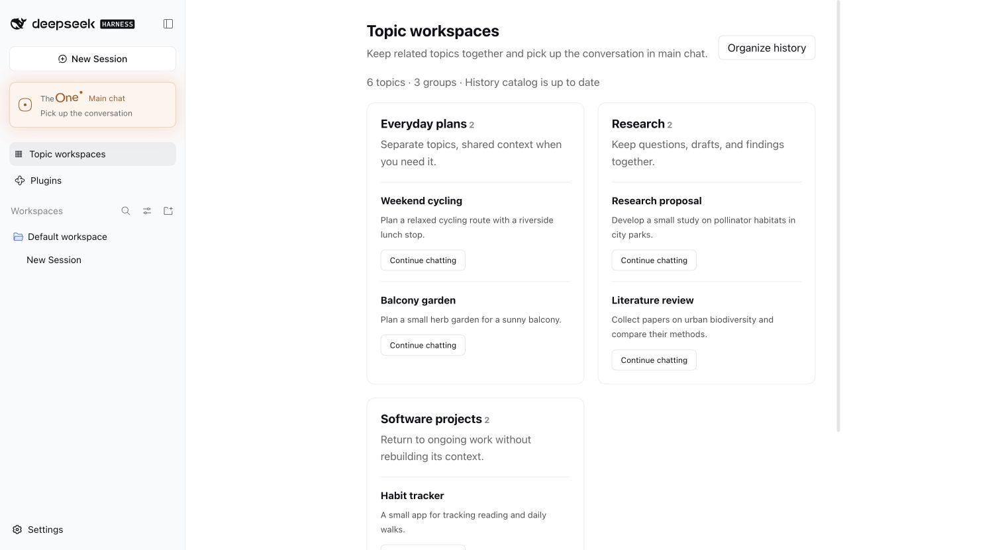

# TheOne guide: how it works, settings and data

[← Back to the README](../README.en.md)

**Contents**

- [How it works](#how-it-works)
- [Settings](#settings)
- [Data and privacy](#data-and-privacy)
- [Known limitations](#known-limitations)
- [From your phone (experimental)](#from-your-phone-experimental)
- [How well does it route?](#how-well-does-it-route)
- [What's next](#whats-next)
- [Development](#development)

## How it works

**Choosing a topic.** Each message is matched to the current topic, an earlier one, or a new one. By default the model you selected makes one short classification (thinking off, at most 2,048 tokens), with candidates recalled through DSH full-text search.

- When the quick decision would start a new topic, ask you, or goes against a number, code or name only one topic has mentioned, the same model looks again with thinking on (about one message in six). If that call fails, the first decision stands.
- Routing never stops to ask where a message belongs. With no credible match it starts a new topic; when it cannot tell which of a few topics you mean, the closest one does the work and the others come along as reference, and the candidates it passed over stay lit in the cluster so you can move the message there; an earlier chat it cannot find continues the current topic, which can search your history itself.
- It asks you only before acting: before a topic first changes a file, runs a command or sends something for the message, if the message may belong to another topic, the change points into another project, or routing itself could not be confirmed (say the routing call timed out), it asks once in main chat, and nothing changes without an answer.
- When one message draws on several topics, the one doing the work gets it and the others come along as reference.
- If the topic that gets a message finds it is not its own, it hands it back before doing anything; TheOne routes it again without that topic, and main chat shows the right topic's answer. Once per message.
- "ok" or "go on" continues the current topic without waiting for a decision, and so does a picture or file sent without words.
- If the classification call fails, rules decide, staying in the current topic when unsure. Rule-based routing (`THEONE_ROUTER_MODE=rules`) makes no model calls at all.

**Linking topics.** A background session starting work receives a reference briefing, and none when there is nothing new:

- right after a topic switch, the last few turns of main chat, so "use what we just said" carries over;
- when the message mentions a number, code or name that only another topic has mentioned, what that topic said about it and where it stands, linked or not;
- what changed in related topics since it last heard: their latest compaction summary (dated) and the progress after it. Topics are related when a message draws on both or one looks the other up; switching between them does not count;
- each topic's constraints, verbatim, every time.

The briefing is marked as reference, not instructions. For details, the background session can use `theone_read_topic` and `theone_search_history` (which can also search every topic that shares with it). Linking scope is **Learn automatically** (default), **Same workspace only** or **Off**. In the directory you can link or unlink topics and mark a topic **Do not share**; your choices always win.

**Topic directory.** Each topic shows its latest progress, the project (DSH workspace) it works in, and its status when that is not plain in progress: **Waiting on you** (it asks you something, or a restart cut its work off), **Set aside** (untouched for longer than you usually come back), or **Done** (you marked it; a new message to it reopens it). In each workspace, topics waiting on you come first and finished ones last; at the top you can filter by status and search titles, summaries and progress. Status is kept apart from the topic's record of what it worked on (its latest 20 messages and how each ended), and is worked out from it. A new topic files itself in the workspace of a topic it draws on, or of the topics in its project folder; you can move it. The **⋯** on a card marks it done or reopens it, and lets you rename, edit the summary and constraints, move to another workspace, merge (the target topic then shows **Undo merge**, which brings the merged topic back as it was), delete, or attach an existing DSH session as searchable history. **New topic** at the top right starts one by hand; the **⋯** beside it holds occasional actions such as organizing history and choosing chats. **Recent topic routing**, further down, lists where each message went, why, with which model and how long it took. With a long history, the first pass takes some time and API quota; set `THEONE_HISTORY_CATALOG=false` to turn it off.



## Settings

TheOne's settings live in DSH's own Settings: open DSH Settings and choose **TheOne** on the left, or right-click the TheOne button in the sidebar and choose **Settings** to go straight there. History catalog and experimental settings apply after a DSH restart; everything else applies when saved.

| Setting | What it does |
| --- | --- |
| Topic notices | How main chat shows topic changes: hidden (default; the topic cluster in the sidebar shows where each message went, and main chat holds only the conversation), one line only when the topic changes, or on every message with the reason |
| Linking scope | Learn automatically (default), same workspace only, or off |
| Model | Follow DSH (default) or pin the background model from any model configured in DSH; a pinned model takes precedence over main chat's selector |
| Routing | LLM decision (default) or rule-based |
| History catalog | On/off and rescan interval |
| Limits | Topic descriptor length; reply length per background step, thinking included |
| Manual catalog file | Optional JSON file of hand-written topics, imported when saved (under **Advanced**) |
| Experimental | At the bottom of the settings, all off by default, applying after a DSH restart: **Share confirmed facts** (topics share only facts the user confirmed, with version and source), **Record facts automatically** (one small model call after each turn records facts a topic left out), **Ongoing tasks** (follow a GitHub PR's checks and hear in main chat when they change; while off, the sidebar has no **Ongoing tasks**) |

The database location and entry identifier switch TheOne to different data, so they are set only through environment variables: `THEONE_DATABASE_PATH` and `THEONE_GATEWAY_KEY`. Also optional: `THEONE_CONTEXTS_PATH` and `THEONE_WORKER_PROVIDER` / `THEONE_WORKER_MODEL` (set both).

## Data and privacy

- Everything stays on your computer. Routing, topic cards and organising old sessions use the model you chose in DSH; requests go straight to that model provider, never through a TheOne server.
- DSH keeps the original conversations and tool results; TheOne keeps only its catalog, summaries, links and routing records in its own SQLite database (`$DSH_HOME/theone/contexts.db`, `~/.dsh/theone/` by default).
- Text sent to the router or written into briefings has API keys, passwords and similar secrets removed.
- A topic marked **Do not share** never appears in other topics' briefings, recent-chat excerpts or lookups.
- Notices from the author are read from `https://yulid.org/theone/notice.json` with a plain request that sends none of your data; turn them off in Settings.
- **Feedback** (bottom of Topic workspaces, or **Report a problem** on a message under Recent topic routing) sends only when you press Send, and shows everything it would send first. By default it holds versions, settings and routing error codes and timings, no chat content; for one message, its text and reply are added only if you tick the box. Reports go to `feedback.yulid.org`, are used only to look into problems and are deleted after 90 days; to have one deleted sooner, email theone@yulid.org with its id.
- When main chat grows long, DSH compacts it through TheOne: frequently used topics keep longer summaries and their latest turns, rarely used ones keep a short status. This makes no model call.
- Updates are installed by DSH's plugin manager and reload TheOne in place; a DSH without plugin hot reload applies them at the next restart.

## Known limitations

- Telling whether a message sent during a reply is about that reply needs the routing model; with rules-only routing, every such message joins the reply, as before.
- A new topic not about any of your projects works in DSH's own folder for chats outside any project (`Documents/deepseek-harness/default-workspace`), or in `~/.dsh/theone/gateway` if you do not have that folder. Topics organised from your existing chats work in those chats' folders.
- Main chat stores copies of tool calls, so its log grows with use; entry-log rotation is not implemented yet.
- Only one DSH process should use a database at a time.
- Image output is not forwarded yet; there is no vector search; a topic cannot be split in two yet (a merge can be undone).
- The tool cards in main chat only show the tools the topic is using; nothing runs a second time. This relies on TheOne sitting first in DSH's tool pipeline; if another plugin also places itself first, it may see these display-only copies, but each tool still runs once.

## From your phone (experimental)

Talk to main chat away from your computer: bind a messaging app in **TheOne Settings**, and what you send from your phone works like typing in main chat. It goes to its topic and runs in the background, and the reply comes back to your phone. Approvals and the AI's questions come too; answer with a number (no answer within 10 minutes declines). Main chat on your computer shows the same conversation. Only you are listened to; nobody else's messages reach main chat.

| App | How to bind | Notes |
| --- | --- | --- |
| WeChat | **Scan to bind** in Settings, then scan with WeChat on your phone | Uses Tencent's iLink interface (the same as the OpenClaw WeChat plugin), a private Tencent protocol; follow WeChat's terms |
| Telegram | Make a bot with @BotFather, paste its token in Settings, then scan the code (or send `/start <code>`) to pair | The token stays on your computer |
| iMessage | Mac only: enter the phone number or Apple ID you text from | Give the app running DSH Full Disk Access, and allow it to control Messages on the first reply |

Messages arrive only while DSH is running, not while the computer sleeps or DSH is closed. After a network drop or a restart it picks up where it left off, without losing or repeating messages.

## How well does it route?

Claims are cheap, so we built a public benchmark, **InterleaveBench**: one person pushing 3–5 things forward in the same chat at once (a trip, a budget, a paper, a training plan…), half in Chinese and half in English, 50 conversations and 2,466 messages, each labelled in advance with the thing it belongs to. Below, the 40-conversation dev split replayed message by message through TheOne's own routing code with DeepSeek V4.1 Flash, thinking off as TheOne routes (messages even a careful human could not attribute are not scored):

| Approach | Messages routed correctly |
| --- | --- |
| TheOne 0.3.38, topic list given up front | **98.7%** |
| TheOne 0.3.38, starting from nothing and creating topics as it goes (your first day) | **96.3%** |
| TheOne 0.3.37 (one quick decision per message), topic list given up front | 92.9% |
| TheOne 0.3.37, starting from nothing | 90.1% |
| Keyword search (BM25), topic list given up front | 73.3% |
| No routing, everything in one chat | 44.5% |
| Keyword search, starting from nothing | 39.9% |
| A new topic for every message | 9.8% |

A few numbers worth knowing:

- These numbers were measured on 0.3.38.
- **On ten conversations kept aside while tuning**, starting from nothing: 97.1% (0.3.37: 90.7%).
- **One thing is split over 1.47 topics** on average (0.3.37: 1.80), and needless questions back to you dropped from 49 to 9.
- **A message landing in another thing's topic**, the mistake that hurts context most: 2.8% when starting from nothing. It is 1.5% with thinking on for every message, so this is what we work on next.
- **Topic cards** are not simulated in the table. With them (as in the plugin), starting from nothing: 96.9%, and 1.9% of messages land in another thing's topic.
- **What it costs:** about one message in six gets the second look; routing costs about $0.5 per thousand messages (one quick decision only: $0.41; thinking on for every message: $0.55), and topic cards add about $0.16.
- Data, code and scoring live in [`eval/`](../eval/README.md); reproduce it, or try another model. The full write-up, with confidence intervals, token use and what did not work, is in [`docs/routing-eval.md`](routing-eval.md) (Chinese).

The conversations are model-written from a script and this version has no assistant replies, so it measures whether messages are routed right, not everything about how chatting feels.

## What's next

For now, TheOne is being refined on DeepSeek Harness, whose background sessions, tools and compaction can be reused as they are: the right place to get "one chat for everything" solid first.

In progress:

- **Better routing**: fewer messages landing in another thing's topic, and looking at a burst of messages together while deciding each one separately.
- **Confirmed facts shared between topics**: a budget, a date, where a file lives, kept current wherever you need it. It is experimental and will only be turned on by default once it passes its benchmark.

Once it is stable, the next step goes beyond DSH:

- **A standalone client**: one interface over different models and providers, opening straight into a single chat;
- **or adapters for other platforms**: the same automatic topics, inside the chat tools you already use.

Which comes first depends on what people need more. If you have a view, say so in [Issues](https://github.com/YunongDai2005/dsh-theone/issues) or by email at [theone@yulid.org](mailto:theone@yulid.org).

## Development

```sh
git clone https://github.com/YunongDai2005/dsh-theone.git
cd dsh-theone
npm ci --ignore-scripts
npm run typecheck
npm test
```

Tests use the real DSH runtime (AgentLoop, Session, SQLite, JSONL persistence, compaction) with a simulated model, and call no external API. `npm run pack:plugin` builds the install package; `npm run install:local` and `npm run start:local` run a separate DSH profile in `~/.dsh-theone`.

Service API: `ctx.theone.searchHistoryDetailed(contextId, query, limit)` searches a topic's reviewed history; `store.addSource(contextId, sessionId, { startSeq, endSeq })` attaches part of a session. Earlier acceptance records: [v0.1](plugin-v0.1.md) and [v0.2](plugin-v0.2.md).
