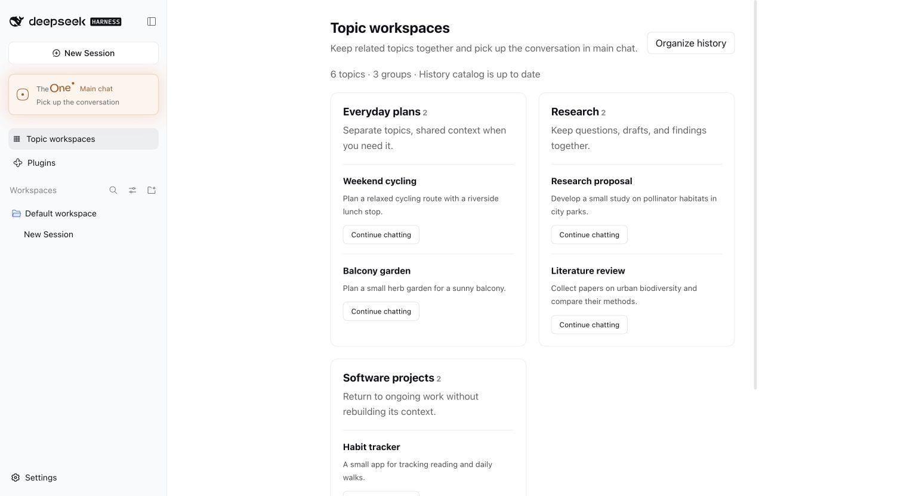

# TheOne 使用说明与工作原理

[← 返回 README](../README.md)

**目录**

- [它是怎么工作的](#它是怎么工作的)
- [设置](#设置)
- [数据与隐私](#数据与隐私)
- [已知限制](#已知限制)
- [在手机上用（实验功能）](#在手机上用实验功能)
- [它分得有多准](#它分得有多准)
- [接下来](#接下来)
- [开发](#开发)

## 它是怎么工作的

**分配话题。** 每条消息先判断：接着当前话题、回到某个旧话题，还是开个新的。默认用你选的模型做一次简短分类（关闭深度思考，最多 2048 token），候选话题由 DSH 全文搜索召回。

- 快速判断要开新话题、要问你，或者和某个只在一个话题里出现过的数字、编号、名字对不上时，同一个模型会开着思考再看一次（大约六条消息一次）；这次调用失败就沿用第一次的判断。
- 分配时不停下来问你消息该放哪里。没有匹配就直接开新话题；分不清是哪几件里的哪一件时，交给最接近的那件，其余作为参考带上，没选中的候选话题在细胞团里亮着，点开就能把消息换过去；提到一段找不到的旧聊天时，接着当前话题，由话题自己去翻历史。
- 要问你的只有一种时候：话题为这条消息第一次改文件、跑命令或发东西之前，如果消息也可能属于别的话题、要改的东西在另一个项目里，或者路由本身没法确认（比如分类调用超时），会先在主聊天问你一次；你没回答就不改。
- 一句话同时用到几件事时，交给真正做事的那件，其余作为参考带上。
- 收到消息的话题如果发现这不是自己的事，会在动手之前交回；TheOne 去掉这个话题重新分配，主聊天显示的是正确话题的回答。每条消息最多交回一次。
- 「好的」「继续」直接接着当前话题，不等判断；只发图片或文件也接着当前话题。
- 分类调用失败时改用规则判断，拿不准就留在当前话题。规则模式（`THEONE_ROUTER_MODE=rules`）完全不调用模型。

**话题联动。** 后台开始工作时会收到一份参考简报，没有新内容就不发：

- 刚切换话题时，附上主聊天最近几轮，「把刚才那个……」能接上；
- 消息里提到的数字、编号、名字如果只在别的某个话题出现过，带上那个话题说过的原话和它的现状，不管两者有没有关联；
- 相关话题自上次以来的变化：最近一次压缩摘要（注明截至时间）和之后的进展。一句话同时用到两件事、或者一个话题去查了另一个，才算相关；来回切换不算；
- 各话题的约束，原样附上，每次都带。

简报标注为参考资料而非指令；需要细节时，后台可以用 `theone_read_topic`、`theone_search_history` 去查（后者也能搜所有允许共享的话题）。联动范围可选「自动学习」（默认）、「仅同一工作区」或「关闭」。在目录里可以手动关联或解除关联、把话题标记为「不共享」，你的设置永远优先。

**话题目录。** 每个话题显示最新进展、它在哪个项目（DSH 工作区）里干活，以及不是普通「进行中」时的状态：**等你处理**（它在问你事情，或者重启打断了它的工作）、**搁置**（比你通常回来的间隔还久没动）、**已完成**（你标的；再有消息发给它就重新打开）。每个工作区里，等你处理的排在最前，已完成的排在最后；页面上方可以按状态筛选，也可以搜索标题、摘要和进展。状态和话题的执行记录（最近 20 条消息各自怎么结束的）分开保存，由执行记录推出来。新话题会自动放进它用到的话题所在的工作区，或者同一项目里话题所在的工作区，你可以再移走。点卡片右上角的 **⋯** 可以标为完成或重新打开、重命名、改摘要和约束、移到别的工作区、合并（合并后目标话题上有「撤销合并」，原话题会原样回来）、删除，或把已有的 DSH 会话关联为可检索的历史。页面右上角的 **新话题** 手动新建，旁边的 **⋯** 里是整理历史、选择会话等不常用的操作。页面下方的 **最近的话题分配** 列出每条消息去了哪里、原因、所用模型和耗时。历史较多时，第一次整理需要一些时间和 API 额度；设置 `THEONE_HISTORY_CATALOG=false` 可关闭。



## 设置

TheOne 的设置在 DSH 自己的设置里：打开 DSH 设置，点左侧的 **TheOne**；也可以右键左侧的 TheOne 按钮，选 **设置**，直接打开这一页。历史整理和测试功能保存后需重启 DSH 生效，其余保存后立即生效。

| 设置 | 说明 |
| --- | --- |
| 话题提示 | 主聊天里怎样显示话题切换：隐藏（默认；每条消息去了哪个话题在侧边栏的话题细胞团里看，主聊天里只有对话）、仅切换时显示一行、每条都显示并注明原因 |
| 联动范围 | 自动学习（默认）、仅同一工作区、关闭 |
| 模型 | 跟随 DSH（默认），或从 DSH 已配置的模型中固定后台模型；固定的设置优先于主聊天里的选择 |
| 路由方式 | LLM 判断（默认）或规则判断 |
| 历史整理 | 开关与补扫间隔 |
| 内容限制 | 话题资料长度；后台每一步回复的长度（含思考） |
| 人工话题目录文件 | 可选的 JSON 话题目录，保存时导入（在「高级」里） |
| 测试功能 | 都在设置最下面，默认关闭，更改后需重启 DSH 生效：**共享已确认的要点**（话题之间只共享用户确认过的要点，带版本和出处）、**自动记录要点**（每轮结束多用一次小模型，补记漏记的要点）、**持续任务**（跟进一个 GitHub PR 的检查结果，有变化时在主聊天通知；关闭时侧边栏不显示「持续任务」） |

数据库位置和主入口标识会让 TheOne 换用另一份数据，只能用环境变量 `THEONE_DATABASE_PATH`、`THEONE_GATEWAY_KEY` 设置。另外可选：`THEONE_CONTEXTS_PATH`，以及须一起设置的 `THEONE_WORKER_PROVIDER` / `THEONE_WORKER_MODEL`。

## 数据与隐私

- 所有数据都在你自己的电脑上。分配话题、写话题卡片、整理旧会话，用的都是你在 DSH 里选的模型，请求直接发给那家模型服务商，不经过 TheOne 的服务器。
- 原始对话和工具结果由 DSH 保存；TheOne 只在自己的 SQLite 数据库（`$DSH_HOME/theone/contexts.db`，默认 `~/.dsh/theone/`）里保存目录、摘要、关联和路由记录。
- 发给路由和写进参考简报的内容会去掉 API Key、密码等敏感信息。
- 标记为「不共享」的话题，不会出现在其他话题的简报、最近对话和查阅结果里。
- 作者发布的公告从 `https://yulid.org/theone/notice.json` 读取，只是一次普通的下载，不发送你的任何数据；可以在设置里关闭。
- **反馈**（话题工作区页面底部，或「最近的话题分配」里每条的「报告问题」）只在你点「发送」时才发出，发送前能看到全部内容。默认只含版本、设置、路由的错误码和耗时，不含聊天内容；报告某条回复时，勾选后才附上那条消息和回复的原文。报告发到 `feedback.yulid.org`，只用于排查问题，90 天后自动删除；想删掉已发的报告，写信到 theone@yulid.org 并附上编号。
- 主聊天变长时，DSH 通过 TheOne 压缩它：常用话题保留较长摘要和最近几轮，不常用的只保留简短状态，不额外调用模型。
- 更新由 DSH 的插件管理器安装，并就地重新加载 TheOne；不支持插件热加载的 DSH 会在下次启动时生效。

## 已知限制

- 判断回答中发的消息是不是关于这次回答，需要路由模型；只用规则路由时，这类消息都会并进当前回答，和以前一样。
- 和你的项目都无关的新话题，在 DSH 自己用来放「不属于任何项目的聊天」的文件夹（`文稿/deepseek-harness/default-workspace`）里干活；没有这个文件夹时，用 `~/.dsh/theone/gateway`。从你已有会话整理出来的话题，照旧在原来的文件夹里干活。
- 主聊天保存了工具调用的副本，长期使用记录会变大；入口日志轮换尚未实现。
- 同一数据库同时只应由一个 DSH 进程使用。
- 图片输出尚未转发；没有向量检索；还不能把一个话题拆成两个（合并可以撤销）。
- 主聊天里的工具卡片只是把话题里正在用的工具显示出来，不会再执行一遍。这依赖 TheOne 排在 DSH 工具流程的最前面；如果别的插件也要排最前面，它可能会看到这些显示用的副本，但工具仍然只执行一次。

## 在手机上用（实验功能）

不在电脑前也能和主聊天说话：在 **TheOne 设置** 里绑定一个聊天软件，之后在手机上发的消息就和在主聊天里打字一样，照常分到话题、在后台干活，回复发回手机。需要你确认的操作和 AI 给的选项也会发过去，回一个数字就行（10 分钟不回按拒绝）。电脑上打开主聊天，看到的是同一段对话。都只认你本人，别人发的消息不会进主聊天。

| 聊天软件 | 怎么绑定 | 说明 |
| --- | --- | --- |
| 微信 | 设置里点「扫码绑定」，用手机微信扫码 | 用腾讯 iLink 接口（和 OpenClaw 微信插件同一套），这是腾讯的私有协议，请遵守微信的使用规范 |
| Telegram | 在 @BotFather 建一个机器人，把 token 填进设置，再扫码（或发 `/start 配对码`）完成配对 | token 只存在这台电脑上 |
| iMessage | 只限 Mac：填你发消息用的手机号或 Apple ID | 需要给运行 DSH 的程序「完全磁盘访问」权限，第一次回复时允许它控制「信息」 |

DSH 开着才能收到消息，电脑睡眠或 DSH 退出时收不到。断网、重启后会自动接着收，不丢也不重复。

## 它分得有多准

口说无凭，我们做了一套公开评测 **InterleaveBench**：模拟一个人在同一个对话框里同时推进 3–5 件事（旅行、记账、论文、健身……），中英文各半，共 50 段对话、2466 条消息，每条属于哪件事都事先定好。下面是用 TheOne 自己的路由代码和 DeepSeek V4.1 Flash（和 TheOne 路由时一样关闭思考），在其中 40 段开发集上逐条重放的结果（连人都分不清的消息不计分）：

| 做法 | 分对的比例 |
| --- | --- |
| TheOne 0.3.38，事先给好话题列表 | **98.7%** |
| TheOne 0.3.38，从零开始边聊边建话题（就是你第一次用的样子） | **96.3%** |
| TheOne 0.3.37（每条消息只做一次快速判断），事先给好话题列表 | 92.9% |
| TheOne 0.3.37，从零开始 | 90.1% |
| 关键词检索（BM25），事先给好话题列表 | 73.3% |
| 什么都不分，全塞进一个会话 | 44.5% |
| 关键词检索，从零开始 | 39.9% |
| 每句话都开一个新话题 | 9.8% |

几个值得一说的数字：

- 以上数字是在 0.3.38 上测的。
- **调参时一直没动过的 10 段对话**，从零开始：97.1%（0.3.37 是 90.7%）。
- **同一件事平均被拆成 1.47 个话题**（0.3.37 是 1.80），无谓地反问你从 49 次降到 9 次。
- **把一件事的消息放进另一件事的话题**（最伤上下文的那种错）：从零开始时 2.8%。每条消息都开思考时是 1.5%，这是接下来要改的。
- **话题卡片**在上表里没有模拟。加上卡片（和插件里一样），从零开始是 96.9%，放进别的话题的降到 1.9%。
- **成本**：大约六条消息里有一条会再看一次；路由每一千条消息约 0.5 美元（只做一次快速判断是 0.41 美元，每条都开思考是 0.55 美元），话题卡片另加约 0.16 美元。
- 数据、代码和打分脚本都在 [`eval/`](../eval/README.md)，可以自己复现，换成别的模型也行。完整的评测记录（置信区间、token 消耗、哪些尝试没用）见 [`docs/routing-eval.md`](routing-eval.md)。

评测数据是模型按剧本生成的，而且这一版还没有助手回复，所以它衡量的是「能不能分对」，不代表真实聊天体验的全部。

## 接下来

TheOne 现在先在 DeepSeek Harness 上打磨：DSH 的后台会话、工具、压缩都能直接复用，适合先把「一个对话框聊所有事」做扎实。

近期在做的：

- **分得更准**：减少消息被放进别的话题；连着发的几句话合在一起看、分开判断。
- **话题之间互通确认过的要点**：比如预算、日期、文件位置，换了话题也能用上最新的值。目前是实验功能，评测达标后才会默认开启。

等它足够稳定，下一步会走出 DSH：

- **一个独立的客户端**：统一接口，背后接不同的模型和服务，打开就是一个对话框；
- **或者各个平台的适配版本**：把同样的「自动分话题」带到你已经在用的聊天工具里。

两条路先走哪一条，取决于大家更需要哪个。有想法的话，欢迎在 [Issues](https://github.com/YunongDai2005/dsh-theone/issues) 里说一声，或者发邮件到 [theone@yulid.org](mailto:theone@yulid.org)。

## 开发

```sh
git clone https://github.com/YunongDai2005/dsh-theone.git
cd dsh-theone
npm ci --ignore-scripts
npm run typecheck
npm test
```

测试使用真实的 DSH 运行时（AgentLoop、Session、SQLite、JSONL 持久化、压缩），只模拟模型，不调用外部 API。`npm run pack:plugin` 生成安装包；`npm run install:local` 和 `npm run start:local` 会在 `~/.dsh-theone` 启动一个独立的 DSH profile。

服务接口：`ctx.theone.searchHistoryDetailed(contextId, query, limit)` 检索话题的已审核历史；`store.addSource(contextId, sessionId, { startSeq, endSeq })` 关联会话的一部分。旧版本验收记录见 [v0.1](plugin-v0.1.zh.md) 和 [v0.2](plugin-v0.2.zh.md)。
