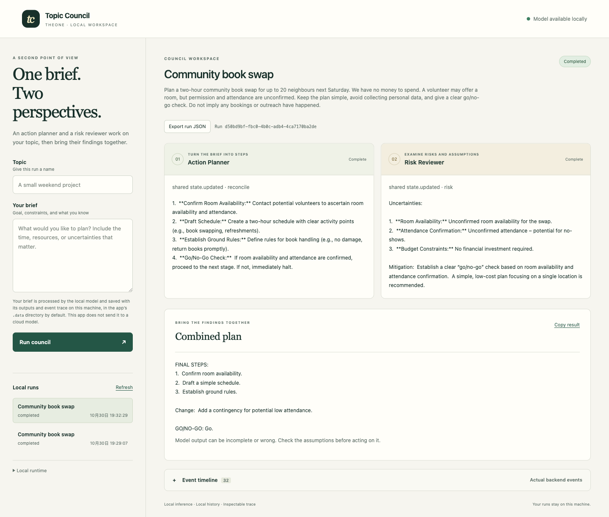

# Topic Council

A local planning workspace for the JigJoy Freestyle track. Give it one topic and a brief. An **Action Planner** and **Risk Reviewer** start separate Mozaik inference loops, share their findings, and produce a combined plan. The browser shows actual backend events and keeps the two perspectives visible.

This application is new work begun on October 30, 2026, after the event kickoff. It lives in a separate TheOne branch and reuses the repository infrastructure. It does not run the TheOne DSH plugin, reuse an earlier contest demo as evidence, or claim a submission, ranking or award. Codex assisted the code and documentation under the author's direction.

## Run locally

Requirements:

- Node.js **24 or newer** and npm.
- A local Ollama installation with **`gemma3:1b` already available** and its applicable model terms satisfied. Model files alone do not prove successful inference. This project does not download weights or create a cloud account.
- A free local port for this app and the local Ollama service. No hosted model key is required.

From the repository root:

```sh
cd examples/jigjoy-topic-council
npm ci --ignore-scripts
```

Use an existing local Ollama service, or start a separate local listener in another terminal:

```sh
OLLAMA_HOST=127.0.0.1:11537 \
OLLAMA_NO_CLOUD=1 \
OLLAMA_NUM_PARALLEL=2 \
OLLAMA_MAX_LOADED_MODELS=1 \
ollama serve
```

These settings keep this listener local, disable Ollama cloud features, allow two requests to the loaded model, and limit it to one loaded model. The two-request setting does not guarantee simultaneous computation on every machine.

Then start the app:

```sh
COUNCIL_OLLAMA_URL=http://127.0.0.1:11537 \
COUNCIL_MODEL=gemma3:1b \
COUNCIL_PORT=3057 \
npm start
```

Open **http://127.0.0.1:3057**. The service binds to loopback. If that port is occupied, use another free `COUNCIL_PORT`; do not stop an unrelated process. `COUNCIL_OLLAMA_URL` must point to the intended local Ollama listener. This prototype supports only `gemma3:1b`; the local runner rejects other model names.

Start from this example directory and do not create a `.env` file here. Before importing the SDK, local mode checks whether `.env` exists and refuses to run if it does; it does not read the file. It clears `MOZAIK_API_KEY` only inside this process to disable SDK telemetry. A Mozaik account is not required, and no saved keys are modified. Configure the local listener and port with the shell variables shown above.

The status indicator checks whether Ollama lists the configured model. It is an availability check, **not a completed inference test**. If the model is unavailable, fix the local configuration and choose **Refresh**. The UI does not insert sample responses when the model is missing or fails.

## Try a run

1. Enter a topic and a brief with a goal, constraints and known uncertainties. A synthetic planning brief is enough to inspect the workflow; avoid private information you do not want kept in local history.
2. Choose **Run council**. The two agent cards update from actual events. They do not use a fixed timer or fabricated progress percentage.
3. Inspect each agent's findings and the combined plan. Open **Event timeline** to see timestamps, agent/loop identifiers and every raw event field received from the backend.
4. Reopen the run from **Local runs**, copy its combined result, or export its JSON trace. **Cancel run** requests cancellation from the backend; the final status comes from the backend rather than being assumed by the browser.

Only one council run is accepted at a time. Two agents run concurrently **within that run**. Starting another run while one is active can return a busy response; wait or cancel the current run.

## How the agents coordinate

```text
Browser brief → local HTTP server → Mozaik runtime
                                      ├─ Action Planner ─┐
                                      └─ Risk Reviewer ──┤
                                                        ↓
                                               shared findings
                                                        ↓
                                             planner reconciliation
                                                        ↓
                                      combined plan + persisted trace
```

The first planner and reviewer loops are started without waiting for one another. The planner turns the brief into actions; the reviewer independently identifies risks, assumptions and missing information. Their outputs enter shared state. A reconciliation loop reads both findings to produce the final result. Sequentially calling two prompts alone would not establish the required concurrent-agent behavior.

The trace can report the SDK inference request intervals and their measured overlap. **Overlapping requests are not proof that the local model computes both requests simultaneously**: Ollama may queue or serialize computation depending on its configuration and hardware. The UI displays the backend's observation and preserves the raw intervals in the exported run; it does not invent concurrency evidence.

Each inference request has an **8,192-token context** and at most **512 output tokens**. Before sending it, the runner limits the aggregate text of all messages to **6,500 UTF-8 bytes**, including instructions, the brief and any shared findings. Bytes are a conservative input bound, not an exact token count. Excess input is rejected rather than trimmed; shorten the brief if a later reconciliation request is too large. A response is accepted only when Ollama reports `done: true` and `done_reason: "stop"`; a response cut off by its output limit fails instead of being presented as a complete answer.

`@mozaik-ai/core` is pinned to **4.0.6**, the version whose runtime API matched the official tutorial inspected during preparation. At the October 28 preflight, npm's `latest` was `4.2.0-beta.18` with a different API. The lockfile pins the chosen package; changing the SDK requires another compatibility check.

## Local storage and boundaries

The brief, results and event history are stored locally. By default the database is `.data/council.db` under this app; `COUNCIL_DB` can select another local path. Model requests go to the configured local Ollama endpoint. The browser uses same-origin requests and a server-issued token for every mutation; no model credentials or provider keys are used by the browser.

This is a local, single-user prototype, not a remotely authenticated shared service. Do not expose its listener to the internet. The model cannot browse, write project files, execute plans or contact external services through this workflow. Its outputs are suggestions and may be incorrect, repetitive or incomplete. A small local model is especially limited on complex planning and risk analysis.

## Validation and known failures

Two real browser-to-server runs completed on **October 30, 2026**. They demonstrate the runtime and shared-state workflow, but the model's final decisions remain unreliable and require human review. No final event submission is claimed here.

The [first run at 11:29 UTC](evidence/first-run-20261030.json) exposed three material defects: the initial planner claimed to have read the reviewer before receiving its findings, the reviewer inferred missing insurance from a zero budget, and the plan suggested sign-up data despite an instruction to avoid collecting personal information. Its original output is retained.

After the prompts changed, the [second run at 11:32 UTC](evidence/run-20261030.json) no longer made the first two claims on this brief. However, its final answer still gave an **unqualified “Go” despite unconfirmed room permission and attendance**. This is a recorded failure of the final decision, not a successful planning recommendation. No bookings, outreach or other external action occurred.

| Observed second-run property | Evidence |
| --- | --- |
| Real agents / SDK loops / model calls | 2 / 3 / 3 |
| Planner/reviewer inference request overlap | 1,783.499 ms |
| Model completion reasons | All three `stop` |
| Development model calls | 7 local: one smoke call and two three-call councils; 0 cloud calls |
| Browser checks | Result visible, no browser errors, no mobile horizontal overflow |
| Persistence | Both runs survived a server stop/restart; no additional model calls |

Inspect the [verification summary](evidence/verification-20261030.json), [browser checks](evidence/ui-check-20261030.json) and [restart receipt](evidence/persistence-20261030.json). In each complete run JSON, `events` includes the local runner's request timing and token counts; `result.trace` contains the SDK events and shared-state updates. `result.plan`, `result.risk` and `result.final` preserve the actual model text, including mistakes. The measured request overlap does not establish simultaneous hardware execution.

The checked environment was **macOS arm64**, **Ollama 0.35.1**, **Mozaik 4.0.6**, with local **`gemma3:1b`** model digest:

```text
8648f39daa8fbf5b18c7b4e6a8fb4990c692751d49917417b8842ca5758e7ffc
```

The app's **23 tests passed, 0 failed**. These are synthetic/mock and local transport boundary checks; they are separate from the seven real local model calls and do not establish model answer quality. Run them with `npm test`.

The actual desktop capture below shows the second run, including its incorrect final “Go.” A [mobile capture](evidence/mobile-20261030.png) is also included.



To repeat the workflow using your own existing local `gemma3:1b` installation, start the Ollama listener and app as described above, enter your brief in the browser, and inspect the actual event timeline. Model versions, hardware and prompts can change both output and timing. You can also run the same council from the terminal against that listener:

```sh
mkdir -p .data
npm run demo -- \
  --endpoint http://127.0.0.1:11537 \
  --topic "A community workshop" \
  --brief "Plan a one-hour workshop for six people using materials already available. Identify assumptions before recommending purchases." \
  --out .data/run-evidence.json
```

This invokes the local model three times: planner, reviewer and reconciliation. The output file contains the actual run and request trace and is created only if that filename does not already exist; choose a new filename for another run. A failed run is reported as a failure, without substitute model output.

## Event requirements

The [official Freestyle brief](https://build.jigjoy.ai/tracks/freestyle) requires coordinated concurrent Mozaik agents and a public repository with clear architecture and run instructions. A video and a publicly hosted demo are not required by that brief. An actual event submission and its confirmation remain separate from publishing source.

The root repository's MIT license applies to this original application code. Mozaik and the chosen model keep their own licenses and terms.
