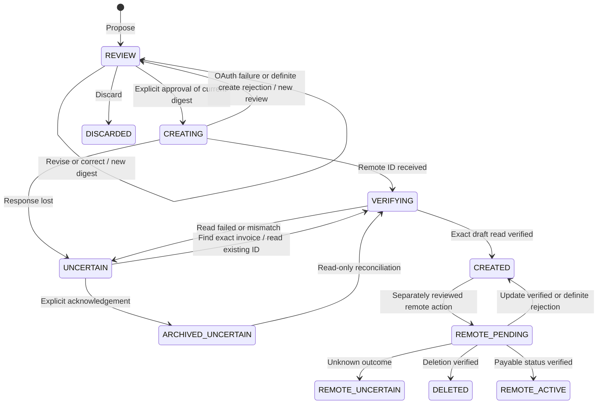

# Invoice workflow revision — November 12, 2026

This is the repair checkpoint for the original single-user backend. Its invoice workflow is also used by the later Studio authorization layer. For the current multiuser application, authentication contract and 108-test verification, see [the current README](README.md), [Studio](STUDIO.md) and [the genuine Studio receipt](evidence/studio-live-2026-11-13.json).

This revision develops the product for a freelancer handling several client projects in one conversation. The useful outcome is a reviewed, unsent PayPal Sandbox invoice whose project, recipient and amount remain consistent as the conversation changes. The repaired backend is now paired with the merged Invoice Desk frontend. The previous frozen UI is retained in [the historical design archive](design-reference/2026-11-12/README.md); the active baseline is [the web interface](design-reference/2026-11-12-invoice-desk/README.md).

## What now works

After proposing a 480 EUR invoice, “Actually, make it 520 EUR” revises the same local draft. Amount, currency and service name can change; a model cannot change the recipient. Project correction remains an explicit action that selects a configured recipient. Revisions preserve the invoice number, create a version snapshot, retain the source message ID and invalidate the earlier review digest. Reverting 520 back to 480 still requires a new review.

The model sees only editable drafts from the routed project, with IDs, revisions and business fields. It does not receive configured recipient addresses. If several drafts are editable, the server requires a unique invoice number, service name or original amount and currency in supported English/Chinese forms (including “€480 invoice”, “480 euro invoice”, “invoice for 480 EUR” and “480欧元的发票”). It checks the full project ledger, includes an explicitly selected older draft in the model window and rejects model guesses or duplicate matches. The requested new amount alone is not a selector. Already-created drafts cannot be changed by chat. Separately reviewed remote operations can update or delete a verified DRAFT, or make it payable through a Sandbox share link without email.

“What is the invoice status for the design client?” selects a database-backed operation. The server replaces the model’s proposed answer with current local records: drafts awaiting review, verified unsent drafts and attempts needing verification. Totals use integer arithmetic and remain separate by currency. These are local workflow totals, not a live PayPal balance or a claim that an invoice was delivered or paid.

If PayPal created a draft but its response was lost, reconciliation searches by the server-generated invoice number. It then reads the single matching invoice and compares its ID, DRAFT status, reference, recipient, item, quantity, currency and total against the reviewed payload. An empty, ambiguous, incomplete or mismatched result remains uncertain. Reconciliation never issues another create request.

## State and review contract



`CREATED` means **an unsent remote DRAFT was successfully verified**. It does not mean sent, paid or completed. A process interrupted in `CREATING` can also be reconciled after restart. Recovery is rejected while a create is still active in the same process.

The approval digest binds both payload and revision. SQLite transactions keep each payload update, version snapshot and audit event together. The journal records proposal, conversational/manual revision, project correction, approval attempt, remote identification, recovery and verification. Existing databases receive a `legacy_snapshot` of their current revision; missing history is not reconstructed or claimed. The journal is an application history, not a tamper-proof external ledger.

`POST /plan` accepts an optional `request_id`. Repeating an ID with the same message returns the original result with `replayed: true`, without repeating inference or creating another local draft. Reusing it with different text fails. The result is stored in the same transaction as the conversation and draft. The replayed proposal is refreshed from current records. The merged frontend supplies a request ID for each submitted message and retains it when a response is lost, so resubmission can replay the saved result. Independently, an identical draft request in the same project reuses the existing active invoice record, even without a request ID; discarded/deleted records do not prevent a new draft.

## Local API

In the original single-user server, all endpoints below require the process-scoped `X-TheOne-Token` obtained from the local page. POST bodies use `application/json`. Existing host/origin and CSP checks remain in place.

| Endpoint | Input / result |
| --- | --- |
| `POST /plan` | `{message, request_id?}`; routes, proposes, revises, clarifies or answers invoice status |
| `POST /revise` | `{id, revision, changes}`; `changes` permits `amount`, `currency`, `description` only |
| `POST /correct` | `{id, revision, topic_id}`; changes the project and configured recipient |
| `GET /proposals/:id/review` | Current digest, revision, exact fields, changes from prior revision and permitted next action |
| `GET /proposals/:id/history` | Version snapshots, message provenance and operation events |
| `GET /projects/:id/brief` | Project-scoped counts and separate currency totals from local records |
| `POST /approve` | `{id, digest}`; creates one unsent Sandbox draft, then reads it back |
| `POST /reconcile` | `{id}`; reads the known remote ID or searches by local invoice number |
| `GET /routing/metrics` | Routing and planning calls, successes/failures, retries, usage and latency for the last 500 journaled attempts |
| `GET /routing/attempts` | Redacted user requests, statuses, errors, and per-call records, including failed turns |
| `POST /discard` | `{id, revision, acknowledge_remote_unknown?}`; discard local REVIEW or explicitly archive unresolved creation |
| `POST /remote/review` | `{id, revision, action, changes?}`; action `update`, `delete` or `publish`; returns separate action digest |
| `POST /remote/apply` | Same reviewed fields plus `digest`; mutates one verified Sandbox draft and verifies the result |
| `POST /remote/reconcile` | `{id}`; resolves a lost remote operation response with GET only |
| `POST /remote/status` | `{id}`; authenticated PayPal read with observation time, status and due amount |
| `GET /state` | Existing frontend contract; proposals are chronological, with the newest last |

Money remains limited to exact USD/EUR/GBP values from 0.01 to 10000.00 per invoice. This revision keeps one line item in the invoice review document. Multi-line invoices, taxes, customer email delivery and payment processing are outside this implementation. Publishing uses PayPal’s `/send` endpoint with both notification flags false; it makes an invoice payable but does not pay it.

The merged frontend displays revision differences and activity history and provides manual edits, project correction, discard, explicit approval and lost-ID recovery controls. Conversational revisions and status questions use the same repaired planning endpoint. Remote update/delete/publication are API-only in the original single-user `index.html`. The separate Studio interface exposes them to authorized finance members with reviewed action digests. See [Studio](STUDIO.md).

## Reproduce the evidence

From this example directory, using Node.js 24+:

```sh
npm test
npm run verify:backend -- backend-evidence.private.json
npm run preview
```

The audit repair also covers server-side deduplication without request IDs, discard, remote update, status and deletion. The backend verification starts a real loopback HTTP server with a temporary SQLite database. It checks sixteen steps, including: proposal, request replay, conversational revision, rejection of stale approval, project correction, lost create response, exact-number recovery and a database-backed status answer, selection between two local drafts by original amount, preservation of the other draft, and honest scripted-call reporting. The test deliberately simulates a remote create followed by connection loss. It asserts one create, one recovery search and five versions, and verifies that `index.html` matches the merged Invoice Desk baseline. Its output explicitly states **simulated providers**. Temporary test data is removed; the normal preview is not mutated.

At this single-user repair checkpoint, the test suite contained **88 passing tests**, including the original routing tests, SQL migration, concurrency, restart persistence, provider response validation and HTTP contracts. All model/PayPal responses in that suite are mocked.

For a separate genuine model check after configuring the existing `.env`:

```sh
node --env-file=.env verify-live-model.mjs live-evidence-model.json
```

This enforces a hard limit of 24 inference calls (including retries/rechecks) across eight synthetic turns covering interleaved projects, revision, grounded status, selection between multiple drafts and ambiguous-client clarification. It stops at the first failure, never substitutes scripted results and performs no PayPal operation. A separate real OpenCode Go / DeepSeek V4.1 Flash evaluation used 24 calls while fixing a guessed-customer path and mixed-language financial replies. The complete post-fix eight-turn scenario subsequently passed using 16 additional calls, including checks that the other invoice remained unchanged. See [the evaluation record](LIVE-MODEL-2026-11-12.md). This model-only check made no PayPal calls. The key was passed only to temporary test processes. October integration evidence remains historical; the current README links the later genuine Studio run.

Operate one server process per database. Concurrent retries in that process and restart recovery are tested; the original single-user server is not a multi-user service. Studio adds separate authenticated member contexts and authorized shared project views; it still requires one workspace process. The preview’s simulated remote store is in memory, so a previously simulated remote ID cannot be reread after restarting that preview process. Genuine Sandbox reconciliation uses PayPal’s persistent records.

See [the audit repair record](AUDIT-REPAIRS-2026-11-12.md) for the backend repair checkpoint, and [the merge record](FRONTEND-MERGE-2026-11-12.md) for the current frontend and integration checks. A later [real Sandbox verification](evidence/sandbox-2026-11-12.json) passed creation, controlled-loss search recovery, update, read and deletion. The later Studio browser run and video add actual member/finance review and a verified remote draft update, as recorded in the current README.

The new routing pass and its pinned v0.4.6 source files are described in [ROUTING-046.md](ROUTING-046.md), including the deliberate financial-workflow deviations, model configuration and evidence boundaries.

## Relevance to the hackathon

The [official criteria](https://paypalaihackathon.devpost.com/rules) emphasize substantive PayPal + AI implementation, coherent product behavior, a specific audience and an end-to-end demonstration. The contribution here is conversational project isolation plus explicit invoice revision and recovery, for people billing multiple clients. The AI interprets the request; server-owned state determines recipients, editable versions, totals and permitted PayPal operations. The failure-recovery demonstration makes that division inspectable.

Official technical references checked November 12, 2026:

- [Fully update invoice](https://developer.paypal.com/api/invoicing/v2/invoices-update/)
- [Send invoice](https://developer.paypal.com/api/invoicing/v2/invoices-send/), including share-link publication without email
- [Invoice lifecycle API](https://developer.paypal.com/api/invoicing/v2/), including draft deletion
- [Create draft invoice](https://developer.paypal.com/api/invoicing/v2/invoices-create)
- [Search invoices](https://developer.paypal.com/api/invoicing/v2/invoices-search-invoices)
- [Show invoice details](https://developer.paypal.com/api/invoicing/v2/invoices-get)
- [PayPal idempotency guidance](https://developer.paypal.com/api/rest/reference/idempotency/), which cautions that header support is API-specific. This implementation does not assume that replaying an invoice-create POST is safe; it uses a persisted local claim and read-only reconciliation.

The local UI, synthetic demonstration and tests are not substitutes for a genuine configured working build for judging. At this repair checkpoint no submission, repository push or deployment had been performed; publication of the later Studio update is a separate step.
